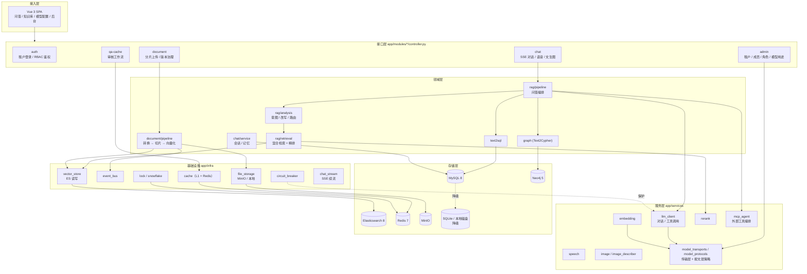
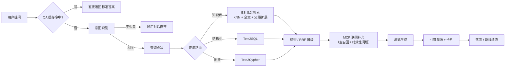
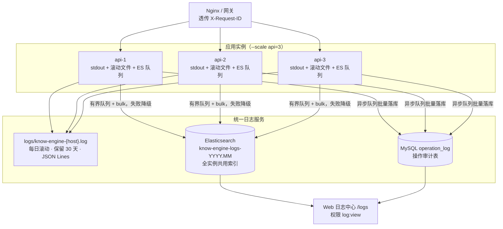

# KnowEngine-Python

**面向企业知识库的 RAG 问答引擎：文档接入 → 混合检索 → 精排 → 流式生成（带引用溯源）**

一套可以「本机一条命令跑通」、也可以「Docker Compose 一键全栈」的知识引擎。后端 FastAPI + SQLAlchemy 2.0（async），前端 Vue 3 + TypeScript，检索侧同时支持 Elasticsearch 向量/全文混合检索、Text2SQL 与 Neo4j Text2Cypher，生成侧通过 SSE 逐字返回并携带结构化卡片与引用来源。


---

## 目录

- [1. 特性速览](#1-特性速览)
- [2. 系统架构](#2-系统架构)
- [3. 技术栈](#3-技术栈)
- [4. 目录结构](#4-目录结构)
- [5. 快速开始](#5-快速开始)
- [6. 配置说明](#6-配置说明)
- [7. 模型接入](#7-模型接入)
- [8. API 概览](#8-api-概览)
- [9. 测试](#9-测试)
- [10. 设计要点](#10-设计要点)
- [11. 常见问题](#11-常见问题)
- [12. 已知限制与路线图](#12-已知限制与路线图)
- [13. 参与贡献](#13-参与贡献)
- [14. 许可](#14-许可)

---

## 1. 特性速览

### 文档接入

- **分片上传**：整文件 MD5 秒传、分片断点续传（缺失分片重传）、`finalize` 合并入库后自动触发处理流水线；前端用 `spark-md5` 增量计算哈希，不依赖 `crypto.subtle`，局域网 http 环境同样可用。
- **多格式解析**：PDF / Word / Markdown / TXT / Excel；可选对接外部解析服务（MinerU），未配置时使用内置 `pypdf` / `python-docx` / `openpyxl`。
- **图片理解**：解析时把文档内图片交给视觉模型生成描述，让图片内容进入可检索文本；控制并发、单图大小与超时，失败降级为位置文案。
- **多策略切片**：Markdown 父子分段、Excel 双模式、固定长度、正则、分隔符、智能切片；支持按新配置对历史版本重新切片。
- **版本治理**：单文档多版本并存、生效版本热切换、版本删除、失败重试、重切片；切换使用乐观锁 `lock_version`。
- **事件驱动流水线**：转换 → 切片 → 向量化 由事件总线串联（Redis Stream 消费组，Redis 不可用时降级进程内），`APScheduler` 定时扫描停滞任务做补偿。

### 检索与生成

- **混合检索**：Elasticsearch KNN 向量召回 + 全文召回 + 混合打分；父子分段二次扩展；三类路由（知识库 / Text2SQL / Text2Cypher）产出统一 `RetrievedChunk`。
- **精排可降级**：DashScope Rerank 优先，未配置或失败时自动降级为 RRF 排名融合 + 词面命中率校验，并在日志中记录降级原因。
- **SSE 流式输出**：`progress / conversation / token / reference / card / answer_message / suggestions / done / error` 全事件协议；用户可中断；刷新页面可通过 `/stream/attach` 续流；流式期间每秒节流回填答案，进程重启不丢内容。
- **引用溯源**：答案附带来源文档、分段标题、相似度与精排分；可点开查看命中片段。
- **结构化问答**：自然语言转 SQL / Cypher，返回对比表卡片。
- **多轮记忆**：滑动窗口上下文 + 滚动摘要 + 会话智能标题 + 推荐追问。

### 多模态与外部工具

- **图片问答**：上传图片走视觉模型直答，跳过检索链路，避免不相关引用与上下文挤占。
- **语音输入**：录音转写（DashScope Qwen-ASR / Whisper 兼容端点）。
- **文生图**：对话页直接生成图片（DashScope 原生异步任务，可取消）。
- **MCP 工具**：支持 stdio（本地进程）与 Streamable HTTP（远程端点）两种传输；知识库检索为空或问题涉及时效性时自动调用联网搜索补充资料，结果保留来源链接。

### 治理与工程化

- **审核式问答缓存**：高频问题挖掘 → 人工审核（通过 / 驳回）→ 上线命中 → 负反馈自动准出，带 TTL。
- **多用途模型配置**：对话 / 图片理解 / 语音识别 / 向量化 / 精排 / 文生图 / 记忆摘要，按「用途」绑定模型，支持连通性测试与本地端点 URL 重写。
- **SaaS 多租户 + RBAC**：租户编码登录、共享库 `tenant_id` 行级隔离；平台超管 / 租户管理员 / 知识库管理员 / 审核员 / 普通成员五级内置角色，权限点驱动前后端路由与接口鉴权。架构细节见 [SaaS 多租户架构](docs/saas/README.md)。
- **双入口认证**：C 端手机号 + B 端工号统一到账号表；图形验证码（一次性、5 分钟有效）；签名令牌；角色感知路由守卫。
- **弹性工程**：tenacity 指数退避、三态熔断、全链路降级、分布式锁、雪花 ID、逻辑删除。
- **可观测**：structlog 结构化日志（JSON / Console 双模式）+ 请求级 `X-Request-ID`；多实例日志统一汇入 ES，操作审计落 MySQL，Web「日志中心」双 Tab 检索。详见 [统一日志服务](docs/observability/logging.md)。

---

## 2. 系统架构



一次问答请求的完整链路：



> QA 缓存不会命中时效性问题：含「今天 / 最新 / 价格 / 版本」等关键词的问题会跳过缓存，并在 system prompt 中注入当前日期。

### 2.3 统一日志服务（多实例）

多副本 / 多机部署时，日志不再散落在各个容器里，而是**统一汇入两个可检索的存储**，本地文件只做留档兜底：



- **系统日志（ES）**：所有实例写同一个按月索引，携带 `service / env / host / instance / request_id / tenant_id / account_id`，可按实例、级别、链路检索；写入走「有界队列 + 后台线程 + bulk」，ES 故障只丢弃日志，不阻塞请求。
- **操作日志（MySQL）**：`operation_log` 记录「谁在什么时间对什么做了什么、结果如何」，写请求由中间件自动记录，登录、租户开通、角色分配等关键操作补充语义字段；同样异步批量落库。
- **本地文件**：`TimedRotatingFileHandler` 每日滚动、保留 30 天，文件名支持 `{host}` 占位，多副本共享卷时各写各的文件，避免滚动冲突。
- **请求链路**：统一生成 / 透传 `X-Request-ID` 并回写响应头，access 日志、业务日志、审计记录共享同一个 request_id，可一键串起「操作 → 调用 → 异常」。
- **统一治理**：structlog 统一格式并接管 uvicorn / SQLAlchemy；敏感字段（密码、Token、Authorization、API Key）落盘前递归脱敏。

配置项见 [6.2 中间件与第三方服务](#62-中间件与第三方服务)，完整设计与排障手册见 [统一日志服务](docs/observability/logging.md)。

---

## 3. 技术栈

| 层次 | 选型 |
| --- | --- |
| 后端框架 | FastAPI 0.115+ · Uvicorn · Pydantic v2 · pydantic-settings |
| 数据访问 | SQLAlchemy 2.0 async · aiomysql · aiosqlite（降级） |
| 检索 | Elasticsearch 8 官方异步客户端 · Neo4j 官方异步驱动 |
| 模型接入 | `openai` 官方 SDK（对话 / 视觉 / 语音 / 文生图）· 自研 httpx 协议（向量化 / 精排 / DashScope 异步任务）· `mcp` SDK |
| 弹性 | tenacity（指数退避）· 三态熔断器 · 全链路降级 · APScheduler（补偿任务）· Redis 分布式锁 |
| 对象存储 | MinIO（`cgr.dev/chainguard/minio`）· 本地磁盘降级 |
| 日志 | structlog（JSON / Console） |
| 前端 | Vue 3 `<script setup>` · TypeScript strict · Vite · Pinia · vue-router · Element Plus · spark-md5 |
| 部署 | Docker 多阶段构建（Node 构建前端 → Python 运行时同源托管）· Docker Compose |

**没有使用 LangChain / LlamaIndex 等编排框架。** 模型供应商之间的协议差异（OpenAI 兼容 vs 阿里原生）由两层策略模式封装：

- `app/services/model_transports.py`：传输层（`ChatTransport` / `SpeechTransport` / `ImageTransport`）。
- `app/services/model_protocols.py`：报文层（`EmbeddingProtocol` / `RerankProtocol`）。

两层正交：换供应商通常只需要改报文层，换 SDK 通常只需要改传输层。

---

## 4. 目录结构

```text
know-engine-python/
├── app/
│   ├── main.py                     # 应用入口：lifespan / 路由 / CORS / SPA 托管
│   ├── config/settings.py          # 配置中心（env 前缀映射）
│   ├── core/
│   │   ├── database.py             # 引擎初始化 / MySQL→SQLite 降级 / 轻量迁移
│   │   ├── deps.py                 # 身份依赖（用户 / 管理员）
│   │   ├── exceptions.py           # 业务异常 + 统一异常处理
│   │   ├── logging.py              # structlog 装配
│   │   └── response.py             # 统一响应信封 R
│   ├── infra/
│   │   ├── cache.py                # L1 进程内 + L2 Redis 缓存
│   │   ├── circuit_breaker.py      # 三态熔断器
│   │   ├── event_bus.py            # 事件总线（Redis Stream / 进程内降级）
│   │   ├── file_storage.py         # MinIO / 本地磁盘统一抽象
│   │   ├── lock.py                 # 分布式锁（Redis / 进程内）
│   │   ├── mcp_client.py           # MCP 客户端（stdio / http）
│   │   ├── snowflake.py            # 雪花 ID
│   │   ├── stop_signal.py          # 会话级停止信号
│   │   ├── chat_stream.py          # SSE 事件分发与续流缓冲
│   │   └── vector_store.py         # ES 索引 / 写入 / KNN / 全文检索
│   ├── models/
│   │   ├── entities.py             # ORM 实体
│   │   ├── constants.py            # 状态 / 意图 / SSE 事件常量
│   │   ├── queries.py              # base_filter / base_count 等查询辅助
│   │   └── seed.py                 # 开发态种子数据
│   ├── services/
│   │   ├── llm_client.py           # 对话 / 流式 / 工具调用（重试 + 熔断）
│   │   ├── embedding.py            # 向量化（批处理 + 降级）
│   │   ├── rerank.py               # 精排（RRF 降级）
│   │   ├── speech.py               # 语音转写
│   │   ├── image.py                # 文生图
│   │   ├── image_describer.py      # 文档图片理解
│   │   ├── mcp_agent.py            # MCP 工具触发策略与编排
│   │   ├── model_transports.py     # 传输层策略
│   │   ├── model_protocols.py      # 报文层策略
│   │   └── prompt_loader.py        # Prompt 模板加载
│   ├── modules/
│   │   ├── auth/                   # 验证码 / 租户登录 / 个人资料
│   │   ├── rbac/                   # 租户 / 角色 / 权限字典 / 授权
│   │   ├── admin/                  # 成员 / 角色 / 租户与模型管理
│   │   ├── model/                  # 模型解析链 / 用途绑定
│   │   ├── document/               # 上传 / 解析 / 切片 / 流水线
│   │   ├── rag/                    # 管道 / 检索 / 分析 / SQL / Cypher
│   │   ├── chat/                   # 会话 / 消息 / SSE / 语音 / 文生图
│   │   └── qa_cache/               # 问答缓存全生命周期
│   ├── prompts/                    # 12 个 Prompt 模板（txt）
│   └── jobs/compensate.py          # 定时补偿任务
├── web/
│   └── src/{api,components,composables,features,router,stores,styles,types,utils}
├── tests/                          # 135 个单测（不依赖中间件）
├── docs/                           # 架构与专项设计文档
├── sql/init/                       # MySQL 首次启动建库建账号
├── docker-compose.dev.yml          # 只启动中间件
├── docker-compose.prod.yml         # 中间件 + 一体化应用
├── Dockerfile                      # 多阶段镜像
├── requirements.txt
└── .env.example
```

---

## 5. 快速开始

### 5.1 环境要求

| 依赖 | 版本 | 说明 |
| --- | --- | --- |
| Docker + Docker Compose | Compose v2 | 一键全栈或只启动中间件 |
| Python | 3.11+（开发验证 3.12） | 本机运行后端 |
| Node | 20+（含 pnpm） | 本机运行前端；`corepack enable` 即可获得 pnpm |

### 5.2 方式一：一键全栈（推荐）

```bash
# 1. 准备配置
copy .env.example .env        # Windows
# cp .env.example .env        # Linux / macOS

# 2. 填入 LLM Key（也可以留空，全链路会降级，但回答质量有限）
#    LLM_API_KEY=sk-xxxx

# 3. 启动（首次构建包含前端打包，耗时较长）
docker compose -f docker-compose.prod.yml up -d --build

# 4. 查看状态与日志
docker compose -f docker-compose.prod.yml ps
docker compose -f docker-compose.prod.yml logs -f api
```

打开 <http://localhost:8009/> 即可。

- 前端构建产物由 FastAPI 同源托管，只暴露一个 Web 端口。
- 容器内服务互访统一使用服务名（`mysql:3306` / `redis:6379` / `elasticsearch:9200` / `neo4j:7687` / `minio:9000`）。
- 宿主访问使用映射端口：Web `8009`、MySQL `3307`、Redis `6379`、ES `9200`、Neo4j `7474/7687`、MinIO `9000/9001`。

### 5.3 方式二：本地开发（前后端热更新）

```bash
# 1. 只启动中间件
docker compose -f docker-compose.dev.yml up -d
docker compose -f docker-compose.dev.yml ps

# 2. 后端
python -m venv .venv
.\.venv\Scripts\Activate.ps1        # Linux/macOS: source .venv/bin/activate
pip install -r requirements.txt
copy .env.example .env
python -m uvicorn app.main:app --host 127.0.0.1 --port 8009 --reload

# 3. 前端
cd web
pnpm install
pnpm dev                             # http://localhost:5173，/api 自动代理到 8009
```

- API 文档：<http://127.0.0.1:8009/api/docs>
- 存活探针：<http://127.0.0.1:8009/api/health>
- 就绪探针：<http://127.0.0.1:8009/api/health/ready>（探测 MySQL/Redis/ES/对象存储，任一依赖不可用返回 503；Redis/ES 未配置属设计内降级，计为 SKIPPED 不阻塞就绪）

### 5.4 方式三：零中间件降级运行

不启动任何容器也能跑通全部接口：

```bash
pip install -r requirements.txt
python -m uvicorn app.main:app --port 8009 --reload
```

此时自动降级为：MySQL → SQLite、Redis → 进程内 TTL、Elasticsearch → MySQL 向量 + numpy 余弦 / LIKE 全文、MinIO → 本地磁盘、Neo4j → 提示改走知识库检索。适合快速体验与调试，不适合生产。

### 5.5 演示账号

SaaS 多租户模式下，登录需同时填写**租户编码**。内置两个租户：`platform`（平台方，id=0）与 `default`（默认租户，id=1）。

| 身份 | 租户编码 | 账号 | 密码 | 可用页面 |
| --- | --- | --- | --- | --- |
| 平台超管 | `platform` | `PLATFORM001` | `123456` | 全部（含租户管理） |
| 租户管理员 | `default` | `TEST001` | `123456` | 智能问答 · 知识文档 · 问答审核 · 模型配置 · 成员管理 |
| 普通成员 | `default` | `13800138000` | `123456` | 智能问答 |

登录需输入图形验证码（点击图片可刷新，一次性有效，5 分钟过期）。演示账号仅在本文件记录，登录页不再展示；种子账号仅在开发态自动写入，生产环境请自行创建并修改默认口令。

**角色与权限（RBAC）**

| 角色编码 | 名称 | 主要权限点 |
| --- | --- | --- |
| `platform_admin` | 平台超管 | `*`（通配全部权限，跨租户视角） |
| `tenant_admin` | 租户管理员 | `member:manage` `role:manage` `model:manage` `document:*` `qa:review` `chat:*` |
| `kb_admin` | 知识库管理员 | `document:read/write/delete` `chat:use` |
| `reviewer` | 审核员 | `qa:review` `document:read` `chat:use` |
| `member` | 普通成员 | `document:read` `chat:use` |

权限点由平台维护（`app/modules/rbac/constants.py`），角色支持租户自建并通过 `/api/admin/roles` 管理；成员可通过 `/api/admin/users/{id}/roles` 批量授权。租户数据按 `tenant_id` 行级隔离，平台超管不受此限。

### 5.6 快速自检

```bash
python -m compileall -q app                                   # 语法 / 编码检查
python -c "import app.main as m; print('routes:', len(m.app.routes))"
python -m pytest tests -q                                     # 135 个单测，无需中间件
```

### 5.7 多实例部署

API 无进程内会话态依赖的关键能力已外置，可水平扩容多个实例后用 Nginx 反向代理：

```bash
# 每个实例都指向同一套中间件；Redis 为多实例强依赖
REDIS__URL=redis://redis:6379/0
SNOWFLAKE__WORKER_ID=1          # 每个实例必须不同（或留空按主机名自动派生）
STORAGE__UPLOAD_ROOT=/mnt/shared/upload_sessions   # 共享卷 / NFS，否则分片上传会断
```

| 能力 | 多实例处理方式 |
| --- | --- |
| 雪花 ID | `SNOWFLAKE__WORKER_ID` 每个实例唯一；未配置时按「主机名:端口」自动派生 |
| 定时补偿任务 | 各实例都启动调度器，任务执行前用 Redis 锁抢占，同一时刻只有一个实例执行 |
| 分片上传 | 会话目录通过 `STORAGE__UPLOAD_ROOT` 指向共享存储 |
| 文档处理事件 | 事件写入 Redis Stream，消费组内一条事件只被一个实例处理；未 ACK 自动重投 |
| SSE 续流 / 停止生成 | 事件缓冲与停止信号写入 Redis，任意实例都能续流和中断；Nginx 会话粘性仅用于减少重连抖动 |
| 熔断锁 / 验证码 / 缓存 | Redis 共享（未配置 Redis 时自动降级为进程内，仅适合单机） |
| 统一日志 | 本地滚动文件 + ES 日志索引双写；所有实例写同一个 `know-engine-logs-*` 索引，Web「日志中心」按 `log:view` 检索；ES 不可用时自动降级为仅本地文件 |

代理配置示例见 [`deploy/nginx.conf`](deploy/nginx.conf)：除会话粘性外，还关闭了响应缓冲与 gzip，
否则 SSE 的 token 会被攒批下发、前端看起来"卡住后才一次性出现"。

多主机部署时共享会话目录需使用 NFS（或改用支持多实例的对象存储方案）。

**同机多副本一键样例**（已实测双副本 + nginx 入口全链路可用）：

```bash
docker compose -f docker-compose.prod.yml -f docker-compose.multi.yml up -d --scale api=3
# 入口：http://localhost:8090 （nginx 经 Docker DNS 轮询到全部副本）
# 扩缩容后重启 nginx 以重新解析副本： docker restart ke-nginx
```

叠加文件 [`docker-compose.multi.yml`](docker-compose.multi.yml) 会用 `!reset` 清除单实例的
`container_name` 与端口映射，并挂载 [`deploy/nginx.compose.conf`](deploy/nginx.compose.conf)
（上游为服务名 `api`，无需手写实例 IP）。

### 5.8 备份与恢复

```powershell
.\scripts\backup.ps1 -IncludeRedis   # MySQL 全量 + MinIO 数据卷（+可选 Redis RDB），输出到 .\backups\
```

- **备份范围**：MySQL（业务全量，分段向量也在库内）+ MinIO（文档原件）。ES 向量索引与 Neo4j 图谱可由 MySQL 重建（重新激活文档或等补偿任务），不纳入备份；上传会话目录是临时数据，无需备份。
- **恢复 MySQL**：先建空库，再 `docker cp backups\mysql-xxx.sql ke-mysql:/tmp/ && docker exec ke-mysql sh -c 'mysql -uroot -p"$MYSQL_ROOT_PASSWORD" know_engine < /tmp/mysql-xxx.sql'`。
- **恢复 MinIO**：停 api 后 `docker run --rm -v know-engine-python_minio-data:/data -v "<backups 绝对路径>:/backup" alpine sh -c 'rm -rf /data/* && tar xzf /backup/minio-data-xxx.tar.gz -C /data'`，再启动 api。
- **重建 ES**：恢复后调用文档「重新激活」或等待补偿任务将分段重新写入索引。

---

## 6. 配置说明

所有配置项都在 `app/config/settings.py`，命名规则为 `段__字段`（双下划线），可通过环境变量或 `.env` 覆盖。

### 6.1 应用与模型

| 变量 | 默认值 | 说明 |
| --- | --- | --- |
| `APP__ENV` | `dev` | `dev` / `prod` |
| `APP__PORT` | `8009` | 监听端口 |
| `APP__SECRET_KEY` | `change-me-in-production` | 令牌签名密钥，**生产必须覆盖** |
| `APP__CORS_ORIGINS` | `["*"]` | 允许的跨域来源 |
| `LLM__API_KEY` | 空 | OpenAI 兼容端点 Key；留空则走降级链路 |
| `LLM__BASE_URL` | DashScope compatible-mode | 任意 OpenAI 兼容端点 |
| `LLM__CHAT_MODEL` | `qwen-plus` | 主对话模型 |
| `LLM__FLASH_MODEL` | `qwen-turbo` | 标题等低延迟辅助任务 |
| `LLM__EMBEDDING_MODEL` | `text-embedding-v4` | 向量模型 |
| `LLM__EMBEDDING_DIMENSIONS` | `1536` | 向量维度（与索引 mapping 对齐） |

### 6.2 中间件

| 变量 | 默认值 | 说明 |
| --- | --- | --- |
| `DB__URL` | `mysql+aiomysql://...@localhost:3307/know_engine` | 业务库 DSN |
| `DB__FALLBACK_SQLITE` | `true` | MySQL 不可达时降级 SQLite；生产建议 `false` |
| `REDIS__URL` | `redis://localhost:6379/0` | 置空则 L2 缓存与锁降级为进程内 |
| `VECTOR__ES_URL` | `http://localhost:9200` | ES 地址；空或不可达时降级 |
| `VECTOR__INDEX_NAME` | `know-engine-chunks-v1` | **改索引名会使存量数据不可见，需重建** |
| `VECTOR__CHUNK_TOP_K` | `30` | 初召回数量 |
| `VECTOR__RERANKED_TOP_K` | `8` | 精排后进入 Prompt 的数量 |
| `NEO4J__URI` | `bolt://localhost:7687` | 图数据库 |
| `NEO4J__PASSWORD` | `neo4j666` | 与 compose 对齐 |
| `STORAGE__ENDPOINT` | `localhost:9000` | MinIO 地址（不带协议） |
| `STORAGE__ACCESS_KEY` / `SECRET_KEY` | `minioadmin` | 与 compose 对齐 |
| `STORAGE__MAX_UPLOAD_BYTES` | `200MB` | 单文件上限 |
| `STORAGE__CHUNK_SIZE` | `5MB` | 推荐分片大小 |
| `LOGGING__LEVEL` | `INFO` | 日志级别 |
| `LOGGING__FILE_ENABLED` | `true` | 是否写本地滚动文件（每日滚动，JSON Lines） |
| `LOGGING__FILE_DIR` | `./logs` | 日志目录；容器建议挂载持久卷 |
| `LOGGING__FILE_NAME` | `know-engine.log` | 文件名，支持 `{host}` 占位（多副本共享卷时各写各的文件） |
| `LOGGING__RETENTION_DAYS` | `30` | 本地日志保留天数 |
| `LOGGING__ES_ENABLED` | `true` | 是否把日志批量写入 ES（复用 `VECTOR__ES_URL`） |
| `LOGGING__ES_INDEX_PREFIX` | `know-engine-logs` | 日志索引前缀，实际按月 `前缀-YYYY.MM` |
| `LOGGING__ES_QUEUE_SIZE` | `20000` | 内存队列上限，满则丢弃（降级不阻塞） |

日志服务设计与排障见 [统一日志服务](docs/observability/logging.md)。

### 6.3 能力开关

| 变量 | 默认值 | 说明 |
| --- | --- | --- |
| `RERANK__ENABLED` | `true` | 精排开关；失败自动降级 RRF |
| `RERANK__MODEL` | `gte-rerank-v2` | 精排模型 |
| `SPEECH__ASR_MODEL` | `qwen3-asr-flash` | 语音识别模型 |
| `IMAGE__MODEL` | `wan2.2-t2i-flash` | 文生图模型 |
| `IMAGE__PARSE_ENABLED` | `true` | 解析文档图片并生成描述 |
| `PARSE__API_URL` | 空 | 外部解析服务（MinerU）；空则用内置解析 |
| `QA_CACHE__ENABLED` | `false` | 审核式问答缓存总开关 |
| `QA_CACHE__TTL_DAYS` | `90` | 审核上线后有效期；`<=0` 表示永久 |
| `QA_CACHE__REVIEWER_IDS` | 空 | 逗号分隔的审核员工号 |

### 6.4 MCP 外部工具

MCP 默认关闭，开启后**只在两种场景**调用外部工具，以控制时延与成本：

1. 知识库检索为空（长尾问题）；
2. 问题含时效性关键词（最新 / 今天 / 新闻 / 价格 / 版本 …）。

```ini
# ${TAVILY_API_KEY} 启动时展开：优先取 .env 里的 TAVILY_API_KEY，未配置则回落到进程环境变量
TAVILY_API_KEY=tvly-xxxxxxxx
MCP__ENABLED=true

# 远程 HTTP（推荐：镜像内无 Node 运行时，stdio 的 npx 类服务用不了）
MCP__SERVERS=[{"name":"tavily","transport":"http","url":"https://mcp.tavily.com/mcp/?tavilyApiKey=${TAVILY_API_KEY}"}]

# 本地 stdio（需要镜像内存在对应运行时）
MCP__SERVERS=[{"name":"search","transport":"stdio","command":"npx","args":["-y","tavily-mcp"],"env":{"TAVILY_API_KEY":"${TAVILY_API_KEY}"}}]
```

> Docker Compose 部署时，`docker-compose.prod.yml` 会把 `MCP_ENABLED` / `MCP_SERVERS` 注入为 `MCP__ENABLED` / `MCP__SERVERS`。  
> 也就是：`.env` 里写 `MCP_ENABLED=true` 与 `MCP_SERVERS=[...]`，本地直跑时写 `MCP__ENABLED` / `MCP__SERVERS`。

内置约束：`timeout_seconds=30`、`max_rounds=3`、`max_tools=20`、`max_result_chars=4000`、`cache_ttl_seconds=300`，防止工具循环失控或结果撑爆上下文。

---

## 7. 模型接入

### 7.1 模型用途（角色）

系统里所有需要模型的位置都通过「用途」解析，后台可以给每个用途单独绑定模型；未绑定时按「同用途默认模型 → 首个启用 → 环境变量」逐级回退。

| 用途 | 需要的能力 | 说明 |
| --- | --- | --- |
| `chat` | chat | 意图识别、问题改写、回答生成 |
| `vision` | vision | 文档图片描述 + 对话看图回答 |
| `speech` | speech | 语音转文字 |
| `embedding` | embedding | 文档入库与问题检索向量化 |
| `rerank` | rerank | 检索结果精排 |
| `image_gen` | image_gen | 文生图 |
| `memory` | chat | 滚动摘要、智能标题、推荐问题（可绑轻量模型） |

### 7.2 协议适配

| 能力 | 默认协议 | 传输实现 | 失败时 |
| --- | --- | --- | --- |
| 对话 / 视觉 / 记忆 | OpenAI 兼容 `chat/completions` | openai SDK → httpx 回落 | 重试 → 熔断 → 降级话术 |
| 工具调用 | OpenAI `tools` + `tool_choice=auto` | openai SDK / httpx | 端点不支持则跳过工具 |
| 向量化 | OpenAI 兼容 `embeddings` 或阿里原生 | httpx 协议策略 | 本地哈希向量 |
| 精排 | DashScope 原生 text-rerank | httpx 协议策略 | RRF 融合 |
| 语音 | OpenAI `/audio/transcriptions` / DashScope 多模态 | httpx | 明确错误提示 |
| 文生图 | OpenAI `images` 或 DashScope 异步任务 | openai SDK / httpx 轮询 | 明确错误提示 |
| MCP 工具 | JSON-RPC（stdio / Streamable HTTP） | 官方 `mcp` SDK | 记录告警，正常生成 |

本地模型（Ollama / vLLM）跑在宿主机时，容器内会自动把 `localhost` 重写为 `host.docker.internal`（compose 已配置 `extra_hosts`）。

---

## 8. API 概览

统一响应信封：`{ success, code, message, data }`；分页数据：`{ total, page_num, page_size, records }`。  
完整契约以 OpenAPI 为准：`/api/docs`。

### 认证 `/api/auth`

| 方法 | 路径 | 说明 |
| --- | --- | --- |
| GET | `/captcha` | 图形验证码 |
| POST | `/login` | 用户登录（手机号 + 租户编码） |
| POST | `/admin-login` | 管理员登录（工号 + 租户编码） |
| GET | `/me` | 恢复当前身份（含租户、角色、权限点） |
| GET / PUT | `/profile` | 个人资料 |
| POST | `/avatar` | 上传头像 |

### 文档 `/api/document`

| 方法 | 路径 | 说明 |
| --- | --- | --- |
| POST | `/upload/init` | 初始化上传会话（MD5 秒传判定） |
| POST | `/upload/chunk` | 上传单个分片 |
| GET | `/upload/status` | 查询已上传分片（断点续传） |
| POST | `/upload/finalize` | 合并分片并入队处理 |
| GET | `/list` | 文档分页列表 |
| GET | `/{doc_id}` | 文档详情 |
| GET | `/{doc_id}/versions` | 版本列表 |
| GET | `/{doc_id}/versions/{version_id}/preview` | 预览转换后的 Markdown |
| GET | `/{doc_id}/versions/{version_id}/preview/bundle` | 预览资源包 |
| GET | `/{doc_id}/versions/{version_id}/preview/content` | 预览原文 |
| GET | `/{doc_id}/versions/{version_id}/segments` | 分段检视 |
| POST | `/{doc_id}/switch-version` | 切换生效版本 |
| POST | `/{doc_id}/delete-version` | 删除指定版本 |
| POST | `/{doc_id}/retry` | 失败重试 |
| POST | `/{doc_id}/resplit` | 按新配置重切片 |
| DELETE | `/{doc_id}` | 删除文档（逻辑删除 + 清理向量） |

### 对话 `/api/chat`

| 方法 | 路径 | 说明 |
| --- | --- | --- |
| POST | `/stream` | SSE 流式问答（核心接口） |
| GET | `/stream/attach` | 断线后重新挂载事件流 |
| POST | `/images` | 上传对话图片 |
| GET | `/models` | 用户可选对话模型 |
| GET | `/references/{chunk_id}` | 引用分段全文 |
| GET | `/conversations` | 会话列表 |
| GET | `/messages` | 会话消息 |
| DELETE | `/conversations/{id}` | 删除会话 |
| GET / PUT | `/preferences` | 问答偏好 |
| GET | `/suggestions` | 推荐问题 |
| POST | `/feedback` | 点赞 / 点踩 |
| POST | `/interrupt` | 中断当前回答 |
| POST | `/speech/transcribe` | 语音转写 |
| POST | `/image` | 文生图 |
| POST | `/image/cancel` | 取消文生图任务 |

SSE 事件：

| 事件 | 载荷 | 说明 |
| --- | --- | --- |
| `conversation` | `conversation_id` | 新会话首个事件 |
| `progress` | `message` | 阶段进度（意图 / 改写 / 检索 / 生成） |
| `token` | `text` | 逐字输出 |
| `reference` | 引用列表 | 来源文档 / 相似度 / 精排分 |
| `card` | 结构化数据 | SQL / Cypher 对比表 |
| `answer_message` | `message_id` | 答案落库后的消息 ID |
| `suggestions` | 问题列表 | 追问建议 |
| `done` / `error` | — | 结束 / 管道级错误 |

### 问答缓存 `/api/qa-cache`（管理员）

| 方法 | 路径 | 说明 |
| --- | --- | --- |
| GET | `/entries` | 缓存条目列表 |
| POST | `/entries/{id}/approve` | 审核通过并上线 |
| POST | `/entries/{id}/reject` | 驳回 |
| POST | `/entries/{id}/disable` | 下线 |

### 后台管理 `/api/admin`（按权限点鉴权）

| 方法 | 路径 | 说明 | 所需权限 |
| --- | --- | --- | --- |
| GET / POST | `/users` | 成员列表 / 创建 | `member:manage` |
| PUT / DELETE | `/users/{id}` | 更新 / 删除成员 | `member:manage` |
| PUT | `/users/{id}/roles` | 批量设置成员角色 | `role:manage` |
| GET | `/roles` | 角色列表（含权限点） | `member:manage` |
| POST / PUT | `/roles`、`/roles/{id}` | 新建 / 编辑角色 | `role:manage` |
| GET | `/permissions` | 权限字典 | `member:manage` |
| GET / POST | `/tenants` | 租户列表 / 开通租户 | `tenant:manage`（平台超管） |
| PUT | `/tenants/{id}` | 编辑租户 / 启停 | `tenant:manage`（平台超管） |
| GET / POST | `/models` | 模型列表 / 新增 | `model:manage` |
| PUT / DELETE | `/models/{id}` | 更新 / 删除模型 | `model:manage` |
| POST | `/models/test` | 连通性测试（按用途发最小请求） | `model:manage` |
| GET | `/model-roles` | 用途视图（当前绑定 + 候选） | `model:manage` |
| PUT | `/model-roles/{role}` | 绑定 / 解绑用途 | `model:manage` |
| GET | `/logs/operations` | 操作日志分页查询（MySQL） | `log:view` |
| GET | `/logs/operations/modules` | 操作日志模块筛选 | `log:view` |
| GET | `/logs/system` | 系统日志分页检索（ES，不可用时返回 degraded） | `log:view` |

### 其他

| 方法 | 路径 | 说明 |
| --- | --- | --- |
| GET | `/api/health` | 存活探针 |
| GET | `/api/health/ready` | 就绪探针（依赖全部可用返回 200，否则 503） |
| GET | `/api/files/{key}` | 对象存储文件回读（免登录只读） |

---

## 9. 测试

测试不依赖数据库、Redis、ES 等中间件，克隆后即可执行：

```bash
python -m pytest tests -q
```

```text
130 passed
```

| 测试文件 | 覆盖内容 |
| --- | --- |
| `test_splitters.py` | Markdown 父子分段、长度 / 正则 / 分隔符 / 智能切片边界 |
| `test_embedding.py` | 批量向量化、维度校验、哈希降级、异常兜底 |
| `test_rerank.py` | 原生协议解析、HTTP 报文、RRF 降级、分数归一 |
| `test_model_transports.py` | SDK / httpx 回落的补全与流式、错误分类、工具调用解析 |
| `test_mcp.py` | 工具名清洗、schema 转换、结果截断、触发策略、工具循环、时效性问题直连搜索 |

---

## 10. 设计要点

### 10.1 全链路降级矩阵

| 依赖 | 缺失 / 故障时行为 |
| --- | --- |
| MySQL | dev 自动切换 SQLite（`DB__FALLBACK_SQLITE=true`），生产建议关闭 |
| Redis | L2 缓存、分布式锁、事件队列、SSE 续流缓冲降级为进程内实现（仅适合单机） |
| Elasticsearch | 向量存 MySQL + numpy 余弦；全文降级 LIKE |
| Neo4j | 图谱路由提示改走知识库检索 |
| MinIO | 本地磁盘目录 `app/data/files`，接口抽象不变 |
| MinerU | 内置 `pypdf` / `python-docx` / `openpyxl` 解析 |
| LLM Key | 跳过改写与路由，直通检索；无生成能力时返回兜底话术 |
| Embedding | 本地哈希向量（可运行，语义质量有限） |
| Rerank | RRF 排名融合 + 词面命中率校验 |
| MCP | 关闭时对话链路不产生任何额外调用与提示 |

设计原则：**任何一环失败都能给用户一个可解释的回复，而不是 500。**

### 10.2 关键约定

- **库内只存路径，不存地址**：文档与图片落库的是对象 key，对外统一走同源相对路由 `/api/files/{key}`，换域名 / 端口 / 反向代理无需迁移数据。
- **软删除过滤统一收口**：`base_filter()` 与 `base_count()` 同时过滤 `deleted == 0`，避免分页 `total` 虚高。
- **QA 缓存不回答时效性问题**：缓存是历史快照，命中「今天 / 最新 / 价格 / 版本」等词时跳过缓存，并在 system prompt 注入当前日期。
- **时效性搜索直连**：模型经常「自信地」编造日期与版本，因此时效性问题由代码直接调用搜索工具，而不是等模型主动发起。
- **纯日期问题不联网**：本地时钟就是权威答案；搜索引擎结果页可能缓存旧日期，反而把答案带偏。
- **SSE 可恢复**：事件同时写入会话缓冲，浏览器刷新后可通过 `/stream/attach` 续流；流式期间每秒节流回填答案。
- **向量空间隔离**：更换向量模型后旧文档需要重新向量化，索引名带版本号，避免新旧向量混检。

---

## 11. 常见问题

**问答返回「AI 生成服务当前不可用」**
未配置 `LLM__API_KEY`。填入有效的 OpenAI 兼容 Key 即可；未配置时后端按设计走降级话术，不影响登录、文档管理等其余功能。

**文档一直停在「解析中 / 向量化中」**
先看 `api` 日志与文档详情里的错误原因；确认 Elasticsearch 健康（`curl localhost:9200/_cluster/health`）。流水线失败后可由管理员点「重试」，`APScheduler` 也会定时补偿停滞任务。

**检索结果为空 / 答非所问**
确认文档已成功向量化、生效版本正确；检查向量模型是否与索引维度一致（`LLM__EMBEDDING_DIMENSIONS` 与 ES mapping）。更换向量模型后必须重建索引。

**`pnpm build` 失败**
确认已 `pnpm install` 且 Node ≥ 20。构建脚本为 `vue-tsc --noEmit && vite build`，类型错误会先于打包暴露。

**改了前端源码没生效**
一体化模式下需要重新 `pnpm build`；日常迭代用 `pnpm dev`（热更新 + `/api` 代理）。

**端口被占用**
后端用 `APP__PORT` 调整，并同步 `web/.env.development` 的 `VITE_API_TARGET`；中间件端口在 compose 的 `ports` 中调整。

**MCP 开启后没有任何工具调用**
1. 确认配置写在 `.env`（不是只写在 `.env.example`）；
2. 本地直跑用 `MCP__ENABLED`，Compose 用 `MCP_ENABLED`；
3. 远程 HTTP 端点需能访问外网；stdio 服务要求镜像内存在对应运行时（`python:3.12-slim` 没有 Node，`npx` 类服务不可用）。

**日期类问题答案不对**
确认提问不是命中历史缓存；时效性问题会跳过缓存并注入当前日期。若服务器时区错误，请在容器设置 `TZ=Asia/Shanghai`。

---

## 12. 已知限制与路线图

**已知限制**

- 事件投递为「至少一次」语义：重复执行由各阶段的状态门与分布式锁保证幂等；同一消息重投 5 次仍失败会丢弃并交由定时补偿兜底。
- 消息队列采用 Redis Stream，未引入 Kafka / RabbitMQ 等独立中间件；多实例的并发控制与状态共享均依赖 Redis。
- 多租户为「共享库 + `tenant_id` 行级隔离」：查询经 SQLAlchemy 会话事件自动注入租户条件，平台超管以 `tenant_id=None` 跨租户访问；尚未做按租户的独立库/独立 schema，也未做租户级配额与计费。
- 权限模型为 RBAC（角色 → 权限点）+ 文档级可见范围：上传时可通过 `accessible_by` 指定可见身份（逗号分隔的工号/手机号，缺省为 `VISITOR` 公开）；登录用户的检索身份随令牌透传，未命中的身份检索不到该文档。部门级授权与数据行级策略（ABAC）未实现。
- 未提供官方 Helm / K8s 部署清单。
- 前端暂无自动化 E2E 测试。

**路线图**

- [x] 事件总线迁移到 Redis Stream，支持消费组、失败重投与多实例共享
- [x] 文档级权限（按身份可见性：`accessible_by` + 令牌透传检索身份）
- [x] 多租户 SaaS（共享库行级隔离 + 租户编码登录）与 RBAC 角色权限模型
- [ ] 租户级配额 / 计费与租户内角色管理界面的细化
- [ ] 检索评估集与离线指标（Recall@K、MRR）
- [ ] 更完整的 OpenAPI 示例与 SDK
- [ ] E2E 测试（Playwright）

---

## 13. 参与贡献

1. Fork 仓库并创建分支：`git checkout -b feat/your-feature`
2. 保持改动聚焦，补充或更新对应单测
3. 提交前自检：

```bash
python -m compileall -q app
python -m pytest tests -q
cd web && pnpm build
```

4. 提交 PR，说明动机、改动范围与验证方式

代码风格：后端遵循 PEP 8 + 类型标注（`from __future__ import annotations`）；前端 TypeScript strict，不使用 `any` 逃逸类型检查。  
提交信息建议使用 Conventional Commits：`feat:` / `fix:` / `refactor:` / `docs:` / `test:`。

更多设计细节见 `docs/`：

| 文档 | 内容 |
| --- | --- |
| [architecture-and-dataflow.md](docs/architecture-and-dataflow.md) | 总体架构、核心链路、数据流转矩阵、状态机 |
| [chat-memory-design.md](docs/chat-memory-design.md) | 会话记忆、滚动摘要、标题生成 |
| [local-rerank-deploy.md](docs/local-rerank-deploy.md) | 本地精排服务部署与踩坑 |
| [rerank-aliyun-adaptation.md](docs/rerank-aliyun-adaptation.md) | 阿里原生精排协议适配 |
| [rerank-current-config.md](docs/rerank-current-config.md) | 当前精排配置说明 |
| [local-speech-deploy.md](docs/local-speech-deploy.md) | 本地语音识别部署指南 |
| [DESIGN.md](DESIGN.md) | 产品与交互设计说明 |

---

## 14. 许可

本仓库目前未附带 `LICENSE` 文件，默认保留所有权利。  
如需商用授权、二次分发或转载，请先通过 Issue 联系作者。
