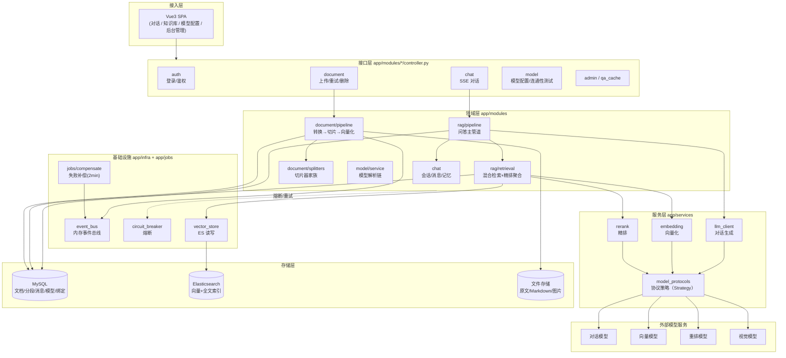
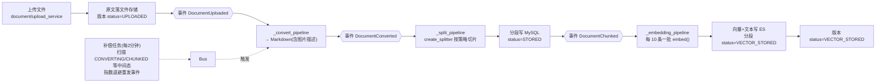
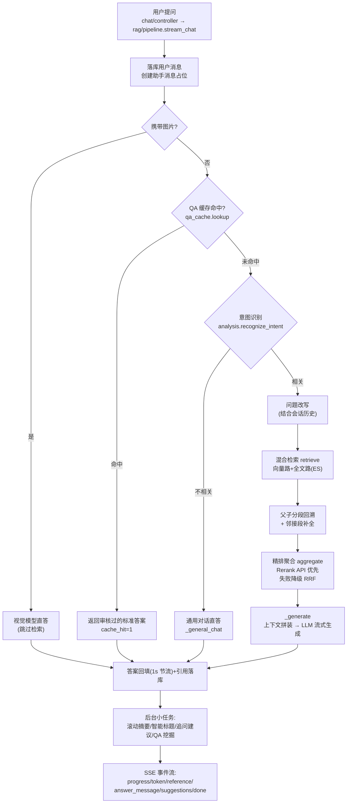
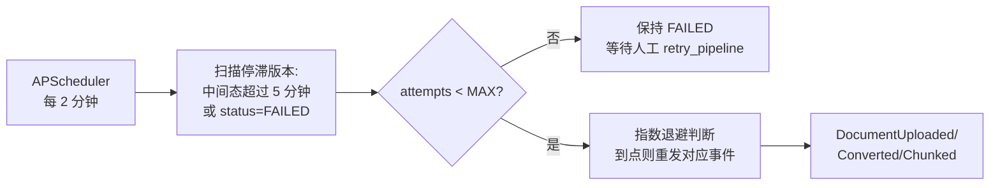
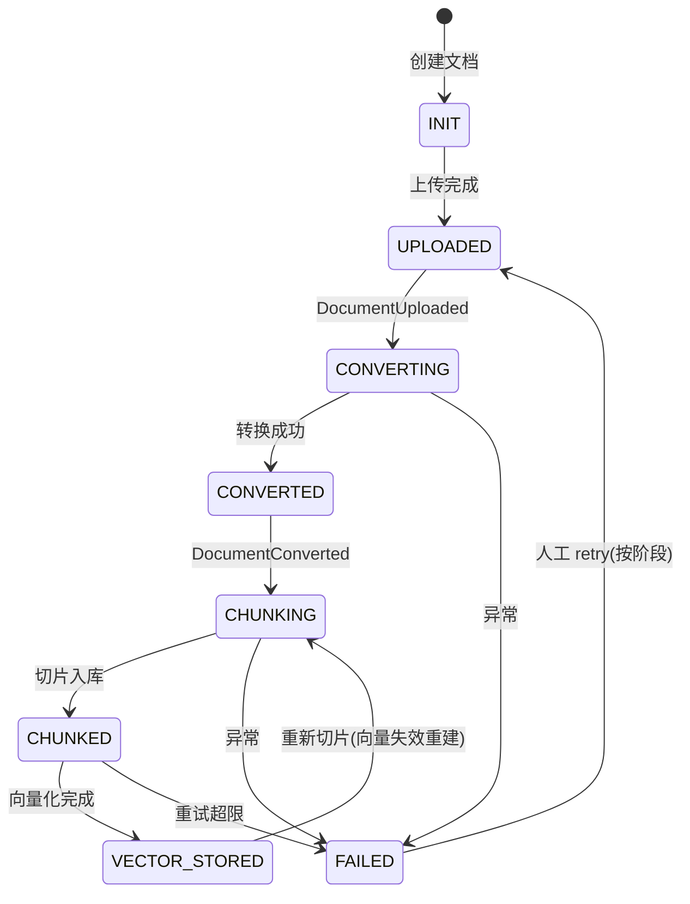

# Know-Engine 系统架构与数据流设计

| 项目 | 说明 |
| --- | --- |
| 文档名称 | 系统架构与数据流设计说明书 |
| 适用范围 | know-engine-python（RAG 知识引擎）全体研发/运维 |
| 文档密级 | 内部公开 |
| 最近更新 | 2026-11-02 |
| 关联文档 | [chat-memory-design.md](./chat-memory-design.md)（记忆与摘要详细设计）、[rerank-aliyun-adaptation.md](./rerank-aliyun-adaptation.md)（重排协议适配） |

## 修订记录

| 版本 | 日期 | 说明 |
| --- | --- | --- |
| v1.0 | 2026-11-02 | 首版：总体架构、五大核心链路流程图、数据流转矩阵、状态机与工程规范约定 |

## 1. 术语表

| 术语 | 含义 |
| --- | --- |
| RAG | Retrieval-Augmented Generation，检索增强生成 |
| 分段（Segment/Chunk） | 文档切片后的最小检索单元，含父子分段协议 |
| 向量空间 | 同一向量模型产出的 embedding 所在的度量空间；**不同模型的向量空间互不兼容** |
| 双协议 | 阿里原生协议（input/parameters 包裹）与 OpenAI 兼容协议（顶层字段） |
| RRF | Reciprocal Rank Fusion，倒数排名融合，精排失败时的降级策略 |
| 补偿任务 | APScheduler 定时扫描停滞/失败的文档版本并重发事件（`app/jobs/compensate.py`） |

## 2. 系统概述

面向企业知识库的 RAG 引擎：文档入库后经「转换 → 切片 → 向量化」进入 Elasticsearch；
用户提问经「QA 缓存 → 意图识别 → 问题改写 → 混合检索 → 精排 → 生成」以 SSE 流式返回答案与引用。

- 后端：FastAPI + SQLAlchemy（async）+ APScheduler
- 存储：MySQL（结构化数据）/ Elasticsearch（向量 + 全文）/ 本地文件存储（原文与转换产物）
- 模型接入：**官方 openai SDK**（对话/视觉/记忆/语音/文生图，OpenAI 兼容协议）
  + **自研 httpx**（向量化/精排的阿里原生协议、DashScope 文生图异步任务）；
  **未使用 LangChain 等编排框架**，协议差异由策略模式封装
  （`app/services/model_transports.py` 传输层、`app/services/model_protocols.py` 报文层）
- 前端：Vue3 SPA（`web/`），对话走 SSE（`app/infra/chat_stream.py`）

## 3. 总体架构



分层职责约束（工程规范）：

1. **controller 只做参数校验与响应组装**，不写业务逻辑；
2. **modules 为领域层**，跨模块调用只允许走对方 `service` 公开函数；
3. **services 为技术能力层**（模型调用、协议适配），不感知业务实体；
4. **infra 为无状态基础设施**（总线/熔断/雪花 ID/锁），任何层可用；
5. 状态/类型一律使用 `app/models/constants.py` 枚举，**禁止散落魔法字符串**。

## 4. 核心链路流程

### 4.1 文档入库流水线（事件驱动）



关键规则：

- 三阶段均为「事件触发 + 状态机推进」，任一阶段失败置 `FAILED`，由补偿任务兜底重试（`MAX_ATTEMPTS` 上限，指数退避）；
- 切片产出父子分段协议：超长章节保留**父分段全文**（`skipEmbedding=1`，不向量化）+ **子分段**携带
  `parentChunkId / brotherChunkId / brotherChunkIndex / brotherChunkTotal`，检索命中子分段时回溯父分段全文；
- 分段序号 `order` 全局连续，供检索侧按 ±1 取邻接段；
- 切片策略矩阵：`SMART/TITLE`（Markdown 标题父子分段，代码块保护）/ `LENGTH`（定长+overlap 滑窗）/
  `REGEX` / `SEPARATOR` / Excel 双模式（KV 每行自包含语义 / HTML 行级完整表格块）。

### 4.2 对话问答流水线（SSE 流式）



降级与保护：

| 环节 | 故障表现 | 降级策略 |
| --- | --- | --- |
| 向量模型不可用 | embed 失败 | 本地哈希 n-gram 投影向量（保链路，日志标注 fallback） |
| 向量维度与索引不符 | ES 400 | 启动时 `probe_dim` 探测真实维度；换模型须重建索引 |
| 精排 API 失败/超时 | rerank 异常 | RRF 多路排名融合（熔断器 3 次失败/60s 恢复） |
| 意图识别失败 | LLM 异常 | 按「相关 + 知识库」继续，不阻断问答 |
| 用户中断 | stop_event | 立即关闭上游 LLM 流，已生成部分照常持久化 |

### 4.3 模型调用协议策略（Strategy 模式）

所有模型调用按「用途」解析运行期配置，差异由两层策略封装，调用方不感知供应商：

| 层 | 策略 | 选择依据 | 实现 |
| --- | --- | --- | --- |
| 传输层 | `ChatTransport` / `SpeechTransport` / `ImageTransport` | 端点协议特征 + SDK 是否可用（缺失自动回落 httpx） | `model_transports.py` |
| 报文层 | `EmbeddingProtocol` / `RerankProtocol` | URL 路径特征（`/api/v1/services/...` = 阿里原生） | `model_protocols.py` |

国内企业主流做法：凡提供 OpenAI 兼容端点的模型（百炼 compatible-mode、智谱、
DeepSeek、Kimi、本地 vLLM/Ollama）统一走官方 `openai` SDK；OpenAI 协议无法
表达的原生异步任务（DashScope 文生图）与阿里原生向量化/精排保留 httpx 直连。

```mermaid
flowchart LR
    Caller["调用方<br/>embedding / rerank / 模型测试"] --> Sel{"按 URL 路径特征选协议"}
    Sel -->|"/api/v1/services/embeddings<br/>/api/v1/services/rerank"| Native["AliyunNative*<br/>input/parameters 包裹<br/>支持 instruct/output_dimension"]
    Sel -->|其他(本地/compatible-mode/OpenAI)| Compat["OpenAICompat*<br/>顶层字段<br/>data[].embedding / query+documents"]
    Native --> Http["httpx 直连 + 熔断 + tenacity 重试"]
    Compat --> Http
    Http --> Parse["保序解析<br/>index / text_index 排序<br/>数量不一致即报错"]
```

解析链优先级（`model/service.py`）：

- 对话：`指定 model_id → chat 用途绑定 → 默认模型 → 首个启用 → 环境变量`
- 向量化/精排/视觉/语音/文生图：`用途绑定 → 同用途默认模型 → 环境变量兜底`
- 记忆摘要（memory）：`memory 用途绑定 → 回退对话模型完整解析链`（见 [chat-memory-design.md](./chat-memory-design.md)）

### 4.4 失败补偿任务



人工干预入口：`document/service.retry_pipeline(doc_id, version_id, stage, force)`，
可按阶段（convert / split / embedding）定点重跑；重切片后自动失效旧向量与 QA 缓存。

### 4.5 记忆与摘要

双层记忆：**滑动窗口（近期原文）+ 滚动摘要（历史压缩）**，记忆后台任务可绑定独立轻量模型（`memory` 用途）。
完整设计（触发时机、摘要 Prompt、Token 预算）见 [chat-memory-design.md](./chat-memory-design.md)。

## 5. 数据流转

### 5.1 存储矩阵

| 数据 | 存储 | 写入方 | 读取方 | 生命周期 |
| --- | --- | --- | --- | --- |
| 文档原文 / Markdown / 图片 | 文件存储 | document/pipeline | 转换、切片、引用预览 | 随文档删除级联清理 |
| 文档 / 版本（状态机） | MySQL | document 模块 | 全链路 | 软删除 |
| 分段（含 embedding 字节） | MySQL | _split/_embedding_pipeline | 检索回溯、补偿 | 重切片整体重建 |
| 分段向量 + 全文 | Elasticsearch | _embedding_pipeline | retrieve 混合召回 | 换向量模型须重建索引 |
| 会话 / 消息 / 引用 | MySQL | chat 模块 | 对话页、SSE 回填 | 软删除 |
| 滚动摘要（长期记忆） | MySQL | _maybe_summarize | get_history 拼上下文 | 随会话 |
| 模型配置 / 用途绑定 | MySQL | model 模块 | 各模型解析链 | 管理端维护 |
| QA 缓存 | MySQL | _mine_qa_cache / 审核 | 对话首道拦截 | 知识库变更即失效 |
| 事件 | 内存总线 | 各 pipeline | 监听器 | 进程内即时消费，不落盘 |

### 5.2 关键数据形态流转

```mermaid
flowchart LR
    File["原始文件<br/>(pdf/docx/md/xlsx)"] --> MD["Markdown 文本<br/>+ 图片描述"]
    MD --> Chunks["Chunk 列表<br/>text + metadata(chunkId/parent/order/…)"]
    Chunks --> SegRow["knowledge_segment 行<br/>status=STORED"]
    SegRow --> Vec["float32 向量<br/>(embedding 字段 + ES dense_vector)"]
    Vec --> Hit["检索命中 (chunk_id, score)"]
    Hit --> Ctx["父分段回溯 + 邻接补全<br/>→ 上下文文本"]
    Ctx --> Prompt["Prompt(历史+摘要+上下文+问题)"]
    Prompt --> Ans["SSE 流式答案 + 引用溯源"]
```



### 5.3 向量一致性红线

1. ES 索引按**固定维度**创建，维度来源为启动时 `probe_dim` 的真实探测值；
2. **更换向量模型 = 更换向量空间**：即使维度相同，旧向量也必须全部重算（重置分段 `status=STORED`、
   清空 embedding、删除旧索引后由补偿任务重跑）；
3. 无向量模型密钥时入库走本地哈希向量，检索侧据此关闭向量路，避免跨空间错配产生噪声。

## 6. 状态机



分段状态：`STORED`（已入库未向量化）→ `VECTOR_STORED`（已向量化）/ `FAILED`。
补偿任务只拾取 `STORED`/`FAILED` 分段，幂等重放不会重复写 ES（chunk_id 主键覆盖）。

## 7. 工程规范约定

| 规范 | 说明 | 位置 |
| --- | --- | --- |
| 枚举常量化 | 状态/类型/SSE 事件/元数据键全部定义于 constants | `app/models/constants.py` |
| 全局唯一 ID | 雪花算法，字符串形态用于 VARCHAR 主键 | `app/infra/snowflake.py` |
| 统一异常 | 业务异常 BizError / ParamError / NotFoundError，全局异常处理器转标准响应 | `app/core/exceptions.py` |
| 熔断与重试 | 外部模型调用必经 CircuitBreaker + tenacity，禁止裸调用 | `app/infra/circuit_breaker.py` |
| 协议策略 | 新增供应商协议 = 新增策略类，禁止在调用方加 if 域名判断 | `app/services/model_protocols.py` |
| 传输策略 | SDK/直连差异封装在传输层，SDK 缺失自动回落 httpx，业务层不感知 | `app/services/model_transports.py` |
| 软删除 | 业务表统一 deleted 标记，查询走 base_filter | `app/models/queries.py` |
| 测试 | 纯单元测试（不依赖 DB/ES/网络），MockTransport 拦截 HTTP；入口 `pytest tests/` | `tests/` |
