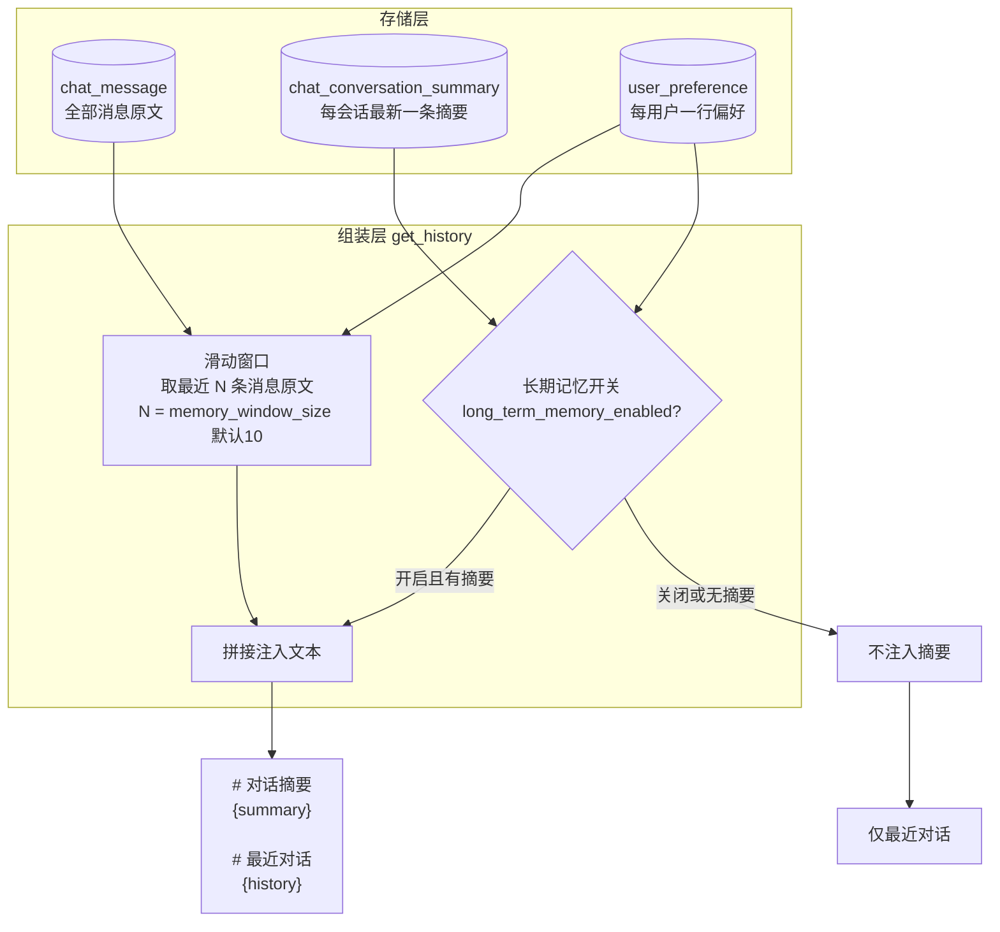
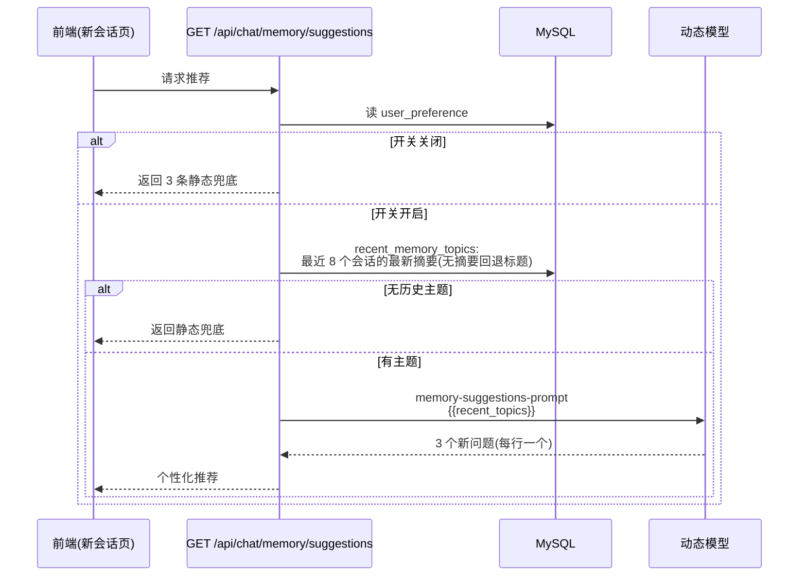
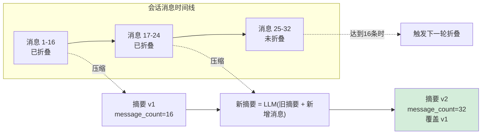
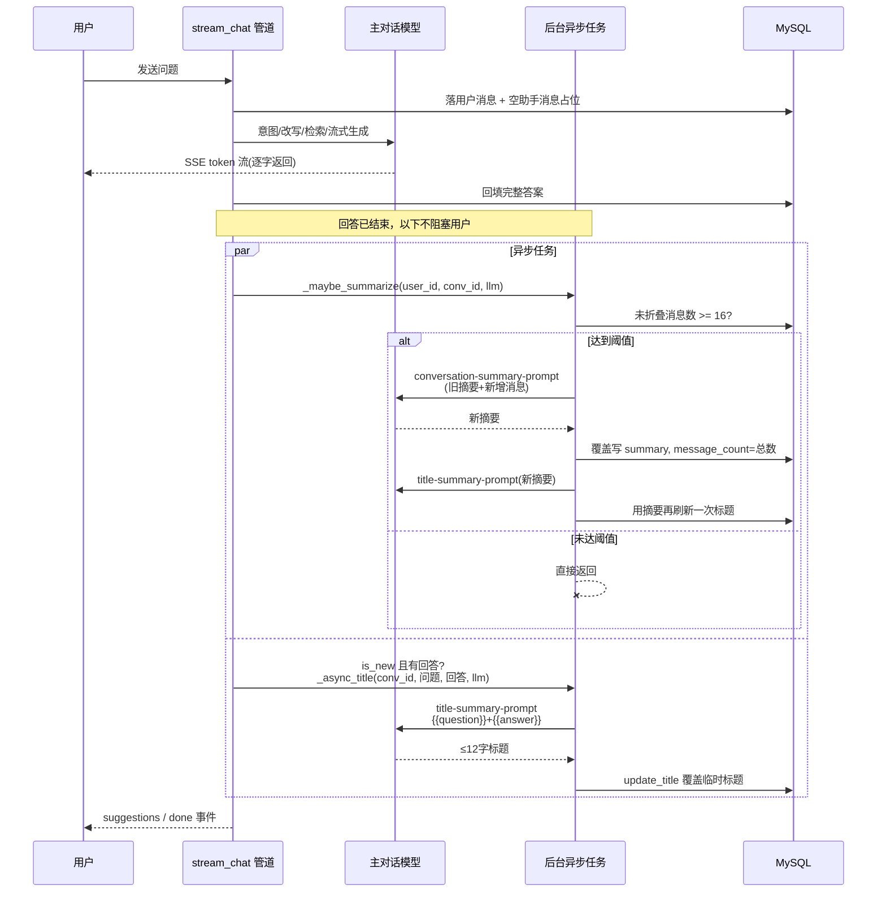

# 对话记忆与会话摘要功能 —— 修复总结与实现设计

> 适用范围：RAG 知识引擎（FastAPI + Vue3）的「长期记忆」「滚动摘要」「智能标题」「新会话推荐」四项能力。
> 本文记录本次修复解决了什么问题、为什么这样改，以及功能的完整实现细节与流程图。

---

## 一、修复总结

### 1.1 解决了什么问题

本次共修复 4 个问题，按严重程度排序：

| # | 问题 | 表象 | 根因 |
|---|------|------|------|
| 1 | **长期记忆完全不生效** | 发了很多条消息后，新建会话没有任何个性化推荐；摘要从未生成；标题永远停留在"首句前 20 字" | `_async_title` / `_maybe_summarize` / `memory_suggestions` 三处辅助 LLM 调用用的是 `get_llm()`（环境变量兜底客户端，无 API key 时 `available=False`，函数第一行就静默 return），而系统真实模型是**数据库里配置的动态模型**（qwen2.5:3b-instruct） |
| 2 | **开关点击后界面无变化** | 点长期记忆开关，请求发出去了，但开关视觉状态不动 | 前端用 `:model-value` 单向绑定，事件处理器只在失败时回滚、成功时从不回写状态 |
| 3 | **开关位置不合理** | 记忆开关属于个人偏好，却放在聊天输入区，每个会话都占一格空间 | 交互设计问题：偏好设置应收敛到「个人设置」弹窗 |
| 4 | **会话标题不可读** | 标题是用户第一句话的前 20 个字，如"Redis 持久化有哪几种方…"，看不出对话真正主题 | 缺少基于对话内容的标题生成逻辑 |

另外还有两个过程中发现并修复的问题：

- `llm.cfg.flash_model` 返回全局硬编码 `"qwen-turbo"`（本地 Ollama 不存在该模型，调用直接报"模型不存在或名称错误"），改为 `llm.flash_model`（解析后的动态模型名），共 5 处。
- 批量替换时一处缩进错误导致 `UnboundLocalError: answer`（E2E 测试暴露），已逐点核对 4 处调用点缩进。

### 1.2 为什么这样做（设计决策）

1. **辅助调用与主链路用同一个模型来源**
   主对话链路走 `model_service.resolve_runtime()` → `get_model_llm(...)`（数据库动态模型），摘要/标题/推荐是同一类"后台 LLM 任务"，没有理由用另一套环境变量客户端。统一后三个功能一次性全部复活。

2. **乐观更新（Optimistic Update）**
   开关是低频、几乎不会失败的操作，先翻转 UI 状态再调 API、失败回滚，交互立即有反馈；相比"等接口返回再动"，感知更跟手。

3. **摘要后置、不阻塞回答**
   摘要和标题生成都是 `asyncio.create_task` 异步任务，挂在回答流结束之后，用户看到回答的速度完全不受影响。

4. **滚动摘要而非全文摘要**
   每次摘要是 `新摘要 = LLM(旧摘要 + 未折叠消息)`，单次调用输入规模恒定（旧摘要 + 最近若干条），不会随会话变长线性膨胀，控制 token 成本。

### 1.3 解决之前 vs 解决之后

| 维度 | 修复前 | 修复后 |
|------|--------|--------|
| 会话标题 | 永远是首句前 20 字，如"Redis 持久化有哪几种方" | LLM 根据「问题+回答」生成摘要式标题，如"Redis 持久化对比与策略"；摘要生成后还会二次刷新为"Redis持久化策略详解" |
| 历史上下文 | 只能带最近 10 条消息，更早的内容完全丢失 | 双层记忆：最近 10 条原文 + 更早内容的滚动摘要，一起注入 Prompt |
| 新会话推荐 | 永远 3 条静态兜底文案 | 基于用户最近会话的摘要/标题，LLM 生成 3 条个性化推荐 |
| 记忆开关 | 点击无视觉反馈；位置在聊天输入区 | 点击即翻转（乐观更新，失败回滚 + Toast 提示）；收敛到「个人资料 → 对话设置」，支持键盘操作 |
| 后台 LLM 调用 | 用 `get_llm()` 兜底客户端，`available=False` 时静默失败，无任何报错痕迹 | 与主链路一致走数据库动态模型，`llm.available=True`（实测 qwen2.5:3b-instruct） |

**实测验证**（临时把 `summary_round_interval` 调为 2 后）：

- 首轮问"Redis 持久化有哪几种方式"→ 标题生成 **"Redis 持久化对比与策略"**
- 第 2 轮触发摘要：日志 `conversation_summarized folded=4 summary_len=442`（内容涵盖 RDB/AOF、appendfsync 等要点），标题同步刷新为 **"Redis持久化策略详解"**
- 新建会话 → 推荐区出现"Redis 持久化方案对比分析 / 性能优化策略 / 深入理解持久化机制"等个性化问题
- 阈值验证：`unfolded=4 < threshold=16`（interval=8 时）正确不触发，不会每轮都摘要

---

## 二、长期记忆的实现

### 2.1 双层记忆架构

长期记忆不是单一机制，而是「短期记忆 + 长期记忆」两层协作：



- **短期记忆** = 滑动窗口：按 `memory_window_size`（默认 10 条，可在 2~100 间配置）取最近消息原文，逐条格式化为 `用户: xxx / 助手: xxx`。
- **长期记忆** = 滚动摘要：开关开启且该会话已有摘要时，摘要以 `# 对话摘要` 段落**前置**在最近对话之前，一起注入改写/意图/生成 Prompt。
- **降级策略**：偏好或摘要查询失败时只记 warning，退回默认窗口、无摘要，绝不影响主对话流程。

注入 Prompt 的最终形态：

```text
# 对话摘要
用户在学习 Redis 持久化，已讨论 RDB 快照与 AOF 日志的差异、
appendfsync 三种刷盘策略的性能取舍……

# 最近对话
用户: 那生产环境一般选哪种？
助手: 一般建议 RDB+AOF 混合开启……
```

模型因此既能"记得"很久以前聊过的结论（摘要），又能看到最近几轮的原话（窗口）。

### 2.2 用户偏好与开关

`user_preference` 表每用户一行（`user_id` 主键）：

| 字段 | 默认值 | 作用 |
|------|--------|------|
| `long_term_memory_enabled` | `true` | 长期记忆总开关（摘要注入 + 新会话推荐） |
| `memory_window_size` | `10` | 短期记忆滑动窗口大小（条数） |
| `summary_round_interval` | `8` | 摘要触发间隔（轮），未折叠消息 ≥ 间隔×2 时触发摘要 |

接口：`GET / PUT /api/chat/preferences`。前端开关收敛在「个人资料 → 对话设置」，采用乐观更新：先翻转状态 → 调 API → 失败回滚并恢复原值；整行带 `role="switch"` + `aria-checked`，支持点击行任意位置和 Space/Enter 键盘切换。

### 2.3 新会话推荐（长期记忆的"对外体现"）

开关开启时，新建会话页会基于该用户**最近会话的摘要**生成 3 个个性化推荐问题：



关键点：推荐的数据源优先取**摘要**而非标题——摘要信息密度更高（修复前因摘要从未生成，这里永远拿到的是兜底文案）。

### 2.4 记忆模型可独立配置

摘要、标题、推荐都是高频小请求（输出只有几百字），与主对话回答的模型诉求不同，因此系统为它们提供了独立的用途绑定：

- 管理后台「模型配置 → 模型用途」新增一项 **「记忆摘要」**（role = `memory`，能力类型 = 对话模型）。
- 绑定后，滚动摘要、会话标题、新会话推荐统一使用该模型；**未绑定时回退到对话模型的完整解析链**（chat 用途绑定 → chat 默认 → 首个启用 → 环境变量），因此不绑定也不会改变既有行为。
- 解析入口：`model_service.resolve_memory_runtime()`；调用方为 [pipeline.py](../app/modules/rag/pipeline.py) 的 `_memory_llm()`（摘要/标题）与 [controller.py](../app/modules/chat/controller.py) 的 `memory_suggestions`（推荐）。
- 候选模型即 `purpose` 含 `chat` 的已启用模型，无需为它单独定义新的 purpose 值——"能做什么"（purpose）与"系统这个位置用谁"（role）保持解耦。

---

## 三、摘要功能的实现

### 3.1 滚动摘要折叠

摘要存储在 `chat_conversation_summary` 表，**每个会话只保留最新一条**（rolling 策略）：

| 字段 | 含义 |
|------|------|
| `conversation_id` | 所属会话 |
| `summary_text` | 摘要正文（≤800 字） |
| `message_count` | 已折叠进摘要的消息条数（关键游标） |
| `token_count` | 摘要 token 数（观测用） |

"折叠"的度量：`未折叠消息数 = 会话总消息数 - message_count`。当未折叠数达到阈值（`summary_round_interval × 2` 条消息，默认 8 轮 = 16 条）时，在回答流结束后异步触发新一轮摘要。



合并由 `conversation-summary-prompt` 完成，要求保留关键事实、决策、技术选型、未解决问题与用户偏好，合并重复信息，≤800 字纯文本。因为是"旧摘要 + 增量消息"而非全文重摘要，**单次调用输入规模恒定**，不随会话长度膨胀。

### 3.2 触发时机与主流程关系

摘要与标题都是回答流结束后的 `asyncio.create_task`，**不阻塞 SSE 主回答流**：



### 3.3 智能标题生成

标题经历"三步演化"：

1. **建会话时**：`ensure_conversation` 先用问题前 20 字落一个**临时标题**，保证列表立即可见。
2. **首轮回答完成后**（`is_new=True`）：`_async_title` 把「问题 + 回答前 800 字」交给 `title-summary-prompt`，要求"优先参考助手回答体现的知识点，而不是照抄用户问句"，产出 ≤12 字标题覆盖临时标题。
3. **每次摘要落库后**：用新摘要再过一次标题 Prompt 刷新标题——因为摘要是整段对话的浓缩，标题越到后期越准确。

标题文本落库前经 `_clean_title` 清洗：去首尾引号/书名号、只取第一行、去句末标点、截断 16 字，防止模型输出带格式杂质。

---

## 四、核心 Bug 复盘：为什么修复前"悄无声息"

修复前最值得记录的教训是**静默失败**：

```text
_async_title / _maybe_summarize / memory_suggestions
    └── get_llm()                    # 环境变量兜底客户端
        └── 无 LLM_API_KEY → available = False
            └── 每个函数第一行: if not llm.available: return
                └── 不报错、不抛异常、日志都没有
                    └── 功能"看起来在跑"，实际什么都没发生
```

用户侧看到的现象（标题不变、无摘要、推荐是兜底）都像是"功能没做"，实际是**功能完整但 LLM 客户端选错了**。修复方式不是改三处逻辑，而是统一模型来源：

```text
model_service.resolve_runtime(None)     # 数据库中当前启用的对话模型
    └── get_model_llm(id, lock_version, base_url, api_key, model_name, ...)
        └── available = True（实测 qwen2.5:3b-instruct）
            └── 三个后台功能一次性全部复活
```

诊断脚本实测对比：修复前 `llm.available: False, flash_model: qwen-plus`；修复后 `True / qwen2.5:3b-instruct`。

---

## 五、关键文件索引

| 功能 | 文件 | 说明 |
|------|------|------|
| 记忆组装 | [service.py](../app/modules/chat/service.py) | `get_history`（窗口+摘要注入）、`count_messages_since_summary`、`recent_memory_topics`、`get_preference` |
| 摘要/标题编排 | [pipeline.py](../app/modules/rag/pipeline.py) | `_maybe_summarize`、`_async_title`、`_clean_title`、4 处回答完成点挂载异步任务 |
| 推荐接口 | [controller.py](../app/modules/chat/controller.py) | `memory_suggestions`（开关检查 → 主题 → 动态模型生成）、偏好 GET/PUT |
| 数据实体 | [entities.py](../app/models/entities.py) | `ChatConversationSummary`、`UserPreference` |
| 摘要 Prompt | [conversation-summary-prompt.txt](../app/prompts/conversation-summary-prompt.txt) | 旧摘要+新增消息 → 合并摘要 ≤800 字 |
| 标题 Prompt | [title-summary-prompt.txt](../app/prompts/title-summary-prompt.txt) | 问题+回答 → ≤12 字标题 |
| 推荐 Prompt | [memory-suggestions-prompt.txt](../app/prompts/memory-suggestions-prompt.txt) | 最近主题 → 3 个新问题 |
| 前端开关 | [AppShell.vue](../web/src/components/layout/AppShell.vue) | 个人资料弹窗「对话设置」，乐观更新 + 无障碍 |

---

## 六、参数速查

| 参数 | 默认值 | 位置 | 说明 |
|------|--------|------|------|
| 窗口大小 | 10 条 | `user_preference.memory_window_size` | 短期记忆取最近 N 条（2~100） |
| 摘要间隔 | 8 轮 | `user_preference.summary_round_interval` | 未折叠消息 ≥ 间隔×2 触发摘要 |
| 摘要上限 | 800 字 | `conversation-summary-prompt` | 单条摘要最大长度 |
| 标题上限 | 12 字（清洗截 16） | `title-summary-prompt` + `_clean_title` | 会话标题长度 |
| 推荐条数 | 3 条 | `memory-suggestions-prompt` | 新会话推荐问题数 |
| 主题窗口 | 8 个会话 | `recent_memory_topics(limit=8)` | 推荐的数据源范围 |
