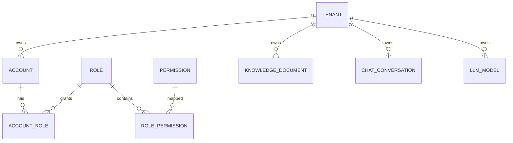
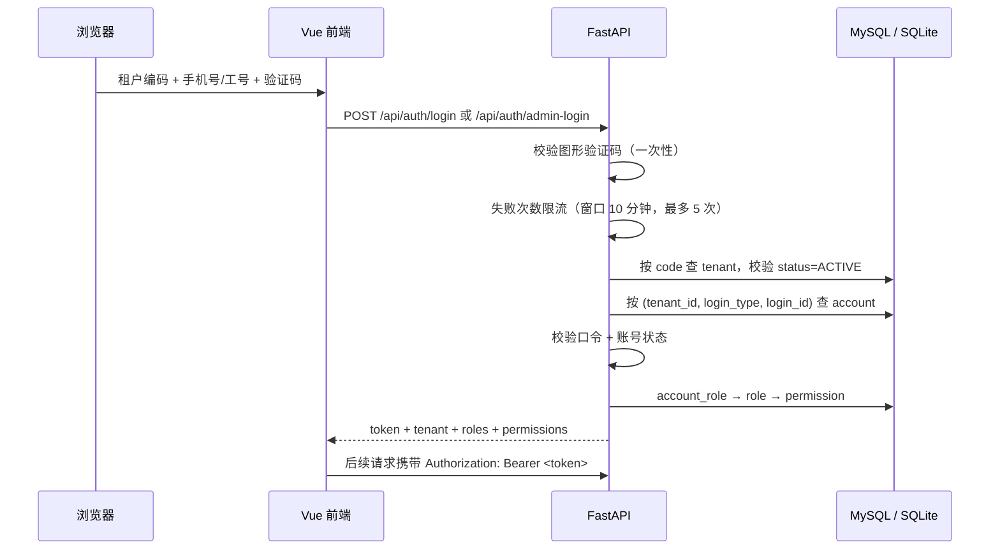
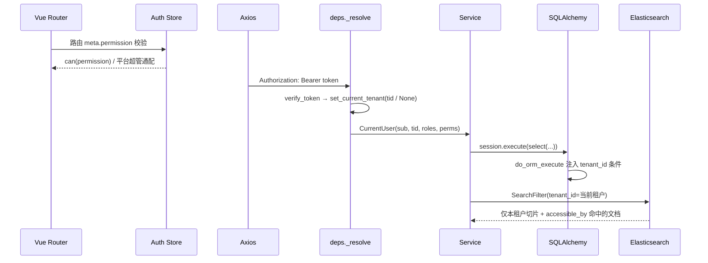

# SaaS 多租户架构

本文档描述 KnowEngine 的 SaaS 多租户改造：数据模型、隔离机制、认证授权、租户生命周期、接口契约与迁移策略。目标读者是需要维护或扩展租户能力的后端/前端开发者。

- 状态：已实现（共享库 + `tenant_id` 行级隔离 + RBAC）
- 技术底座：FastAPI · SQLAlchemy 2.0 async · MySQL 8 / SQLite · Elasticsearch
- 关联文档：[整体架构与数据流](architecture-and-dataflow.md)

---

## 目录

- [1. 设计决策](#1-设计决策)
- [2. 领域模型](#2-领域模型)
- [3. 数据隔离机制](#3-数据隔离机制)
- [4. 认证与会话](#4-认证与会话)
- [5. RBAC 授权模型](#5-rbac-授权模型)
- [6. 租户生命周期](#6-租户生命周期)
- [7. 一次请求的完整链路](#7-一次请求的完整链路)
- [8. API 契约](#8-api-契约)
- [9. 存量数据迁移](#9-存量数据迁移)
- [10. 前端实现](#10-前端实现)
- [11. 扩展指南](#11-扩展指南)
- [12. 验证与测试](#12-验证与测试)
- [13. 已知限制与演进](#13-已知限制与演进)
- [14. 关键文件索引](#14-关键文件索引)

---

## 1. 设计决策

| 维度 | 选择 | 原因 |
| --- | --- | --- |
| 隔离粒度 | 共享库 + `tenant_id` 行级隔离 | 改造成本低、运维简单，适合中小规模 SaaS；后续可按大客户拆分独立库 |
| 账号模型 | 统一 `account` 表（手机号 / 工号） | 去掉 `user_info` / `admin_info` 双表，身份差异完全交给 RBAC，避免权限两套逻辑 |
| 租户识别 | 登录页输入租户编码 | 同一套域名下支持多租户；令牌内固化 `tid/tcode`，避免每次请求再查库 |
| 授权模型 | RBAC（角色 → 权限点） | 权限点由平台维护，租户可自建角色；接口、路由、导航共用同一套权限码 |
| 平台视角 | 平台超管 `tenant_id = None` | 平台需要跨租户运维，隔离钩子在上下文为 `None` 时自动不加过滤 |
| 存量兼容 | 新列默认 `tenant_id = 1` | 老数据平滑归入默认租户，无需停机迁移 |

两个保留租户：

| id | code | 用途 |
| --- | --- | --- |
| `0` | `platform` | 平台自身，平台超管账号归属；不出现在租户列表 |
| `1` | `default` | 默认租户，存量数据与访客默认归属 |

---

## 2. 领域模型



### 2.1 tenant

| 字段 | 类型 | 说明 |
| --- | --- | --- |
| `id` | BIGINT PK | `0` 平台、`1` 默认租户、其余为业务租户 |
| `code` | VARCHAR(64) UNIQUE | 登录时输入，格式 `^[a-z][a-z0-9_-]{2,31}$` |
| `name` | VARCHAR(128) | 租户名称 |
| `status` | VARCHAR(32) | `ACTIVE` / `DISABLED`，停用后该租户账号无法登录 |
| `plan` | VARCHAR(32) | 套餐标识，默认 `STANDARD` |
| `remark` | VARCHAR(255) | 备注 |

`tenant` 自身**不参与**行级隔离（`__tenant_scoped__ = False`），否则平台超管将无法列举租户。

### 2.2 account

统一账号表，登录标识在**同一租户内**唯一：

| 字段 | 说明 |
| --- | --- |
| `login_id` | 手机号或工号 |
| `login_type` | `PHONE` / `EMP` |
| `password` | 口令哈希 |
| `name` / `nickname` / `job` | 展示信息 |
| `avatar` / `motto` | 个人资料 |
| `status` | `ACTIVE` / `DISABLED` |
| `tenant_id` | 所属租户；平台账号为 `0` |

唯一约束：`uk_account_login (tenant_id, login_type, login_id)`。

### 2.3 role / permission / 关联表

| 表 | 关键字段 | 说明 |
| --- | --- | --- |
| `role` | `tenant_id`、`code`、`name`、`is_builtin` | `tenant_id = 0` 为平台内置角色，租户可复用；租户自建角色写自己的 `tenant_id`；唯一约束 `(tenant_id, code)` |
| `permission` | `code`、`name`、`module` | 全局字典，平台维护，租户不可增删 |
| `account_role` | `account_id`、`role_id` | 账号与角色多对多 |
| `role_permission` | `role_id`、`permission_id` | 角色与权限点多对多 |

非租户实体（`tenant` / `role` / `permission` / 关联表）显式声明 `__tenant_scoped__ = False`，通过业务条件（如 `Role.tenant_id.in_([0, scope])`）控制可见范围。

---

## 3. 数据隔离机制

### 3.1 上下文：ContextVar

请求进入时，认证依赖把租户 ID 写入 `ContextVar`；异步调用链共享同一上下文，无需透传参数。

```python
# app/core/tenant.py
_current_tenant: ContextVar[int | None] = ContextVar("current_tenant_id", default=None)

def get_current_tenant() -> int | None:
    """None 表示不做租户过滤（仅平台超管）。"""
    return _current_tenant.get()

@contextmanager
def tenant_scope(tenant_id: int | None):
    """临时切换租户，退出自动恢复；供后台任务/定时任务使用。"""
    token = _current_tenant.set(tenant_id)
    try:
        yield
    finally:
        _current_tenant.reset(token)
```

### 3.2 自动过滤：SQLAlchemy 会话事件

所有需要隔离的实体继承 `TenantMixin`：

```python
class TenantMixin:
    __tenant_scoped__ = True
    tenant_id: Mapped[int] = mapped_column(BigInteger, default=1, nullable=False, index=True)
```

`install_tenant_guards()` 在数据库初始化完成后注册一次（幂等），对每条 `SELECT / UPDATE / DELETE` 自动追加条件：

```python
@event.listens_for(Session, "do_orm_execute")
def _inject_tenant_filter(execute_state) -> None:
    tenant_id = get_current_tenant()
    if tenant_id is None:
        return
    if not (execute_state.is_select or execute_state.is_update or execute_state.is_delete):
        return
    for mapper in Base.registry.mappers:
        entity = mapper.class_
        if not getattr(entity, "__tenant_scoped__", False):
            continue
        tid = tenant_id  # 见下方“缓存陷阱”
        execute_state.statement = execute_state.statement.options(
            with_loader_criteria(entity, lambda cls: cls.tenant_id == tid, include_aliases=True)
        )
```

新增对象在 `flush` 前自动补齐租户：

```python
@event.listens_for(Session, "before_flush")
def _stamp_tenant(session, _flush_context, _instances) -> None:
    tenant_id = get_current_tenant()
    if tenant_id is None:
        return
    for obj in session.new:
        if getattr(type(obj), "__tenant_scoped__", False) and getattr(obj, "tenant_id", None) is None:
            obj.tenant_id = tenant_id
```

> **缓存陷阱（已修复）**：租户 ID 必须用**闭包变量**捕获，不能写成 `lambda cls, _tid=tenant_id:`。默认参数不进入 SQLAlchemy 的语句缓存键，后续租户会复用首个租户的过滤条件，导致跨租户越权。修复后不同租户各命中独立缓存条目。

### 3.3 覆盖范围

已接入自动隔离的实体（均继承 `TenantMixin`）：

`knowledge_document`、`knowledge_document_version`、`knowledge_segment`、`chat_conversation`、`chat_message`、`chat_conversation_summary`、`user_preference`、`llm_model`、`model_role_binding`、`table_meta`、`tech_article`、`knowledge_subscription`、`qa_cache_entry`、`qa_cache_lookup`、`account`。

`model_role_binding` 使用复合主键 `(tenant_id, role)`，避免不同租户绑定同一用途时主键冲突。

### 3.4 ORM 之外的显式隔离

自动钩子只覆盖 SQLAlchemy ORM。以下位置需显式带上租户：

| 位置 | 实现 |
| --- | --- |
| Elasticsearch 向量索引 | `ChunkRecord.tenant_id`；mapping 增加 `tenantId: long`；查询 filter 增加 `term tenantId` |
| ES 不可用时的 DB 兜底检索 | `KnowledgeSegment.tenant_id == filter.tenant_id` |
| 检索入口 | `retrieval.py` 构造 `SearchFilter(..., tenant_id=get_current_tenant())` |
| 文档处理流水线 | `pipeline.py` 写入 `KnowledgeSegment.tenant_id` 与 `ChunkRecord.tenant_id` |
| 问答缓存 | `qa_cache_entry` 唯一索引从 `fingerprint` 改为 `(tenant_id, fingerprint)` |
| 模型用途绑定 | `model/service.py` 按当前租户读写 `ModelRoleBinding` |

---

## 4. 认证与会话

### 4.1 登录流程



失败话术统一为「账号或密码错误」，且租户不存在与停用也走失败计数，避免账号/租户枚举。

### 4.2 令牌载荷

`itsdangerous.URLSafeTimedSerializer` 签名令牌，有效期由 `app.token_ttl_seconds` 控制：

```json
{
  "sub": "12",
  "identity": "admin",
  "name": "演示管理员",
  "rid": "TEST001",
  "tid": 1,
  "tcode": "default",
  "roles": ["tenant_admin"],
  "perms": ["document:read", "document:write", "member:manage", "..."]
}
```

| 字段 | 用途 |
| --- | --- |
| `sub` | 统一账号 id，会话归属键 `owner_key = identity:sub` |
| `identity` | `admin` / `user`，仅用于展示与兼容；权限不看该字段 |
| `rid` | 检索身份（工号/手机号），用于文档 `accessible_by` 过滤 |
| `tid` / `tcode` | 租户 id / 编码，解析时写入租户上下文 |
| `roles` / `perms` | 登录时快照；角色调整后需重新登录才生效 |

平台超管在令牌中同时携带 `roles=["platform_admin"]` 与 `perms=["*"]`。

### 4.3 请求解析

`app/core/deps.py::_resolve` 同时支持 `Authorization: Bearer` 与 `?token=`（EventSource 无法设置请求头），并在此处设置租户上下文：

```python
roles = tuple(data.get("roles") or ())
tid = int(data.get("tid", DEFAULT_TENANT_ID))
# 平台超管跨租户；其余账号只看到本租户数据
set_current_tenant(None if RoleCode.PLATFORM_ADMIN in roles else tid)
```

未携带令牌时按访客处理，租户上下文固定为默认租户 `1`，`is_guest = True`，检索身份为 `VISITOR`。

---

## 5. RBAC 授权模型

### 5.1 权限点（平台维护）

| 权限码 | 名称 | 模块 |
| --- | --- | --- |
| `tenant:manage` | 租户管理 | platform |
| `member:manage` | 成员管理 | tenant |
| `role:manage` | 角色管理 | tenant |
| `model:manage` | 模型配置 | tenant |
| `document:read` | 文档查看 | document |
| `document:write` | 文档上传 / 切片 | document |
| `document:delete` | 文档删除 | document |
| `qa:review` | 问答审核 | qa_cache |
| `chat:use` | 智能问答 | chat |
| `chat:audit` | 会话审计（查看全部会话） | chat |

### 5.2 内置角色

| 权限点 | 平台超管 | 租户管理员 | 知识库管理员 | 审核员 | 普通成员 |
| --- | :---: | :---: | :---: | :---: | :---: |
| `tenant:manage` | ✓（`*`） | — | — | — | — |
| `member:manage` | ✓ | ✓ | — | — | — |
| `role:manage` | ✓ | ✓ | — | — | — |
| `model:manage` | ✓ | ✓ | — | — | — |
| `document:read` | ✓ | ✓ | ✓ | ✓ | ✓ |
| `document:write` | ✓ | ✓ | ✓ | — | — |
| `document:delete` | ✓ | ✓ | ✓ | — | — |
| `qa:review` | ✓ | ✓ | — | ✓ | — |
| `chat:use` | ✓ | ✓ | ✓ | ✓ | ✓ |
| `chat:audit` | ✓ | ✓ | — | — | — |

- 平台超管权限为通配 `*`，接口仅判断「拥有该权限」即可，无需为超管单独写分支。
- 内置角色写在各租户可复用（`role.tenant_id = 0`）；租户自建角色编码不得与内置角色冲突。
- `role:manage` 与 `member:manage` 分离：可以配置「只能分配角色、不能改成员资料」的岗位。

### 5.3 后端鉴权

接口统一使用依赖工厂，满足任意一个权限点即放行：

```python
def require_permission(*permissions: str):
    async def _guard(user: CurrentUser = Depends(get_current_user)) -> CurrentUser:
        if user.is_guest:
            raise HTTPException(status_code=401, detail="需要登录")
        if not any(user.has(p) for p in permissions):
            raise HTTPException(status_code=403, detail="没有操作权限")
        return user
    return _guard
```

```python
@router.delete("/documents/{doc_id}")
async def delete_document(doc_id: int,
                          user: CurrentUser = Depends(require_permission(PermCode.DOC_DELETE))):
    ...
```

租户边界在控制器统一收敛：平台超管可传 `tenant_id` 跨租户，租户账号的 `tenant_id` 被忽略并强制为本租户。

```python
def _scope_tenant(user: CurrentUser, tenant_id: int | None = None) -> int | None:
    if user.is_platform_admin:
        return tenant_id
    return user.tenant_id
```

`/api/admin/tenants` 系列仅 `require_platform_admin` 可访问。

### 5.4 权限检查语义

- 前端隐藏菜单只是体验优化，**不作为安全边界**；所有接口仍由后端权限点校验。
- `identity` 字段不参与鉴权，仅用于展示（如资料表单展示「姓名 / 昵称」）。
- 角色变更即时写库，但已签发令牌中的 `roles/perms` 是快照；需要重新登录或重新签发令牌才会刷新。

---

## 6. 租户生命周期

### 6.1 开通

`POST /api/admin/tenants`（平台超管）在同一事务内完成：

1. 校验租户编码唯一与格式；
2. 创建 `tenant`（`status=ACTIVE`）；
3. 创建该租户的管理员账号（工号登录，`login_type=EMP`）；
4. 绑定内置角色 `tenant_admin`。

```python
tenant = Tenant(code=req.code, name=req.name, status="ACTIVE", plan=req.plan, remark=req.remark)
session.add(tenant)
await session.flush()

role_id = (await session.execute(
    base_filter(Role).where(Role.tenant_id == 0, Role.code == RoleCode.TENANT_ADMIN)
)).scalar_one().id
account = Account(tenant_id=tenant.id, login_id=req.admin_login_id, login_type="EMP",
                  password=hash_password(req.admin_password), name=req.admin_name or req.admin_login_id)
session.add(account)
await session.flush()
session.add(AccountRole(account_id=account.id, role_id=role_id))
```

### 6.2 启停与编辑

- `PUT /api/admin/tenants/{id}` 支持 `name / plan / remark / status`；编码不可改。
- `status=DISABLED` 后，登录阶段直接拒绝；已签发令牌在有效期内仍可访问（见[已知限制](#13-已知限制与演进)）。
- 平台租户 `id=0` 不可编辑、不可停用。

### 6.3 租户内成员与角色

| 操作 | 接口 | 说明 |
| --- | --- | --- |
| 成员列表 / 创建 / 更新 / 删除 | `/api/admin/users*` | 租户管理员固定本租户；平台超管可传 `tenant_id` |
| 批量设置角色 | `PUT /api/admin/users/{id}/roles` | 平台超管按账号回查所属租户后授权 |
| 角色列表 | `GET /api/admin/roles` | 返回内置 + 本租户自建角色及其权限点 |
| 新建 / 编辑角色 | `POST /api/admin/roles`、`PUT /api/admin/roles/{id}` | 仅租户自建角色可改，内置角色只读 |

### 6.4 种子数据

`seed_if_needed()` 在应用启动时幂等执行：

- 写入权限字典与内置角色；
- 确保 `platform(0)`、`default(1)` 两个租户；
- 创建演示账号：

| 身份 | 租户编码 | 账号 | 密码 |
| --- | --- | --- | --- |
| 平台超管 | `platform` | `PLATFORM001` | `123456` |
| 租户管理员 | `default` | `TEST001` | `123456` |
| 普通成员 | `default` | `13800138000` | `123456` |

生产环境请替换默认口令或关闭演示种子。

---

## 7. 一次请求的完整链路



---

## 8. API 契约

### 8.1 认证 `/api/auth`

| 方法 | 路径 | 说明 |
| --- | --- | --- |
| GET | `/captcha` | 图形验证码（一次性，5 分钟） |
| POST | `/login` | 用户登录：`tenant_code` + `phone` + `password` + 验证码 |
| POST | `/admin-login` | 管理员登录：`tenant_code` + `emp_id` + `password` + 验证码 |
| GET | `/me` | 当前身份：`tenant` / `roles` / `permissions` |
| GET / PUT | `/profile` | 个人资料 |
| POST | `/avatar` | 上传头像 |

### 8.2 后台管理 `/api/admin`

| 方法 | 路径 | 所需权限 |
| --- | --- | --- |
| GET / POST | `/users` | `member:manage` |
| PUT / DELETE | `/users/{id}` | `member:manage` |
| PUT | `/users/{id}/roles` | `member:manage` |
| GET | `/roles` | `role:manage` 或 `member:manage` |
| POST / PUT | `/roles`、`/roles/{id}` | `role:manage` |
| GET | `/permissions` | `role:manage` 或 `member:manage` |
| GET / POST | `/tenants` | 平台超管 |
| PUT | `/tenants/{id}` | 平台超管 |
| GET / POST | `/models` | `model:manage` |
| PUT / DELETE | `/models/{id}` | `model:manage` |
| POST | `/models/test` | `model:manage` |
| GET | `/model-roles` | `model:manage` |
| PUT | `/model-roles/{role}` | `model:manage` |

### 8.3 业务接口权限

| 模块 | 读 | 写 / 操作 |
| --- | --- | --- |
| 知识文档 `/api/document` | `document:read` | 上传/重试/切换版本 `document:write`；删除 `document:delete` |
| 问答审核 `/api/qa-cache` | `qa:review` | 通过/驳回 `qa:review` |
| 智能问答 `/api/chat` | `chat:use` | 会话审计 `scope=all` 需 `chat:audit` |

---

## 9. 存量数据迁移

启动时由 `init_database()` 完成，全部幂等：

1. `Base.metadata.create_all` 建缺失表（新库直接带 `tenant_id`）。
2. 对存量业务表检查并补齐列：

```sql
ALTER TABLE knowledge_document ADD COLUMN tenant_id BIGINT NOT NULL DEFAULT 1;
-- 覆盖表见 app/core/database.py::_TENANT_TABLES
```

3. `install_tenant_guards()` 注册会话钩子。
4. `seed_if_needed()` 清理旧演示表、写入权限/角色/租户/账号。

迁移后所有存量数据归属 `tenant_id = 1`（`default`）。如需给客户拆分数据，可在运维窗口执行 `UPDATE ... SET tenant_id = ? WHERE ...`，再用 `tenant_scope()` 校验。

> **注意**：会话归属键 `owner_key` 由旧账号 id 生成（`user:<id>` / `admin:<id>`）。统一账号表后 id 空间变化，存量会话建议在升级窗口清理或按新账号重映射，避免不同账号命中同一 `owner_key`。

---

## 10. 前端实现

### 10.1 认证 Store

`web/src/stores/auth.ts` 保存 `tenant / roles / permissions`，并提供：

```ts
const ALL = '*'
function can(permission: string): boolean {
  return permissions.value.includes(ALL) || permissions.value.includes(permission)
}
function canAny(...items: string[]): boolean {
  return items.some((p) => can(p))
}
```

- `isPlatformAdmin`：角色含 `platform_admin`；
- `isAdmin`：角色命中 `ADMIN_ROLE_CODES`（仅影响展示，不参与鉴权）；
- 刷新后 `loadMe()` 通过 `/auth/me` 恢复租户与权限点。

### 10.2 路由守卫

```ts
const permission = to.meta.permission as string | undefined
if (permission && auth.isAuthenticated && !auth.can(permission)) {
  return { name: 'chat' }
}
```

路由权限映射：

| 路由 | 权限点 |
| --- | --- |
| `/documents` | `document:read` |
| `/qa-cache` | `qa:review` |
| `/models` | `model:manage` |
| `/users` | `member:manage` |
| `/tenants` | `tenant:manage` |

### 10.3 导航与页面

- `AppShell.vue` 的 `NAV` 每项声明 `permission?`，按 `can()` 过滤，租户管理入口仅平台超管可见。
- 登录两页均新增「租户编码」输入（必填，带格式校验），随请求提交 `tenant_code`。
- 成员管理页支持登录方式（手机号/工号）、登录标识、角色多选；角色标签来自 `/api/admin/roles`。
- 租户管理页 `TenantManageView.vue` 提供搜索、开通（含初始管理员）、编辑套餐与启停，桌面表格 + H5 卡片两套布局。

---

## 11. 扩展指南

### 11.1 新增需要隔离的表

1. 实体继承 `TenantMixin`；
2. 在 `app/core/database.py::_TENANT_TABLES` 增加表名，让存量库自动补列；
3. 查询继续用 ORM（自动过滤）；如写原生 SQL，必须显式带 `tenant_id`；
4. 若涉及 ES / Redis / 对象存储，索引或 key 需带租户维度。

### 11.2 新增权限点

1. 在 `app/modules/rbac/constants.py::PermCode` 增加枚举；
2. 加入 `PERMISSION_CATALOG`（启动时幂等写入 `permission` 表）；
3. 按需加入 `BUILTIN_ROLES` 的权限集合；
4. 接口使用 `require_permission(PermCode.NEW_CODE)`；前端在路由 `meta.permission` 与导航 `permission` 同步。

### 11.3 后台任务切租户

事件消费者、定时任务没有 HTTP 上下文，需显式切换：

```python
from app.core.tenant import tenant_scope

with tenant_scope(tenant_id):
    await do_something()
```

未切换时默认为 `None`（平台视角，不过滤），会看到全部租户数据，务必在任务入口显式指定。

---

## 12. 验证与测试

```bash
# 后端全量单测（135 个，不依赖中间件）
python -m pytest tests -q

# 前端类型检查与构建
cd web
pnpm type-check
pnpm build
```

已覆盖并人工验证的关键场景：

- 种子数据：两个租户、三类演示账号、内置角色与权限点；
- 租户管理员 / 普通成员登录，令牌载荷含 `tid / tcode / roles / perms`；
- 平台超管登录，权限为 `["*"]`，租户上下文为 `None`；
- 行级隔离：同一查询在租户 1 / 租户 2 / 平台视角下返回不同结果；
- 权限守卫：无权限访问后台接口返回 403，未登录返回 401；
- 前端：`vue-tsc --noEmit` 与 `pnpm build` 通过。

---

## 13. 已知限制与演进

| 限制 | 影响 | 演进方向 |
| --- | --- | --- |
| 共享库单库 | 大租户数据量与索引互相影响 | 按租户路由到独立库/schema；引入分库中间件 |
| 令牌权限为快照 | 角色调整后需重新登录 | 缩短 TTL + 引入令牌版本号/黑名单 |
| 停用租户不吊销令牌 | 停用后旧令牌在 TTL 内仍可用 | 请求解析时校验租户状态，或维护租户级吊销列表 |
| 无租户配额与计费 | 无法按套餐限流 | 增加 `tenant.quota` 与用量统计（调用量/存储/成员数） |
| 无部门/数据行级策略 | 复杂组织授权需多角色组合 | 引入部门树与 ABAC 策略 |
| 对象存储 key 未带租户前缀 | 依赖文档记录鉴权 | 新上传 key 增加 `tenant/{tid}/` 前缀，配合签名 URL |
| 存量会话归属键可能冲突 | 老库升级后会话归属异常 | 升级脚本清理或重映射 `chat_conversation.owner_key` |

---

## 14. 关键文件索引

| 能力 | 文件 |
| --- | --- |
| 租户上下文与隔离钩子 | `app/core/tenant.py` |
| 权限字典与内置角色 | `app/modules/rbac/constants.py` |
| 租户 / 角色 / 授权服务 | `app/modules/rbac/service.py` |
| 租户与角色请求模型 | `app/modules/rbac/schemas.py` |
| 租户 / 账号 / 角色实体 | `app/models/entities.py` |
| 存量库补列与初始化 | `app/core/database.py` |
| 种子数据 | `app/models/seed.py` |
| 登录 / 令牌 / 资料 | `app/modules/auth/service.py` |
| 身份解析与权限依赖 | `app/core/deps.py` |
| 后台管理接口 | `app/modules/admin/controller.py` |
| 向量检索租户过滤 | `app/infra/vector_store.py`、`app/modules/rag/retrieval.py` |
| 文档流水线租户写入 | `app/modules/document/pipeline.py` |
| 前端认证 Store | `web/src/stores/auth.ts` |
| 前端路由守卫 | `web/src/router/index.ts` |
| 导航权限过滤 | `web/src/components/layout/AppShell.vue` |
| 成员管理 | `web/src/features/admin/UserManageView.vue` |
| 租户管理 | `web/src/features/admin/TenantManageView.vue` |
